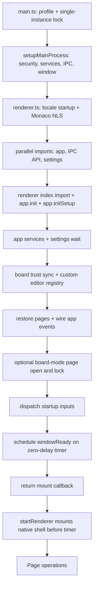
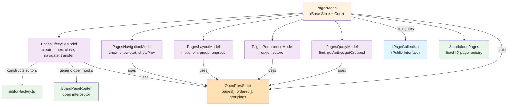
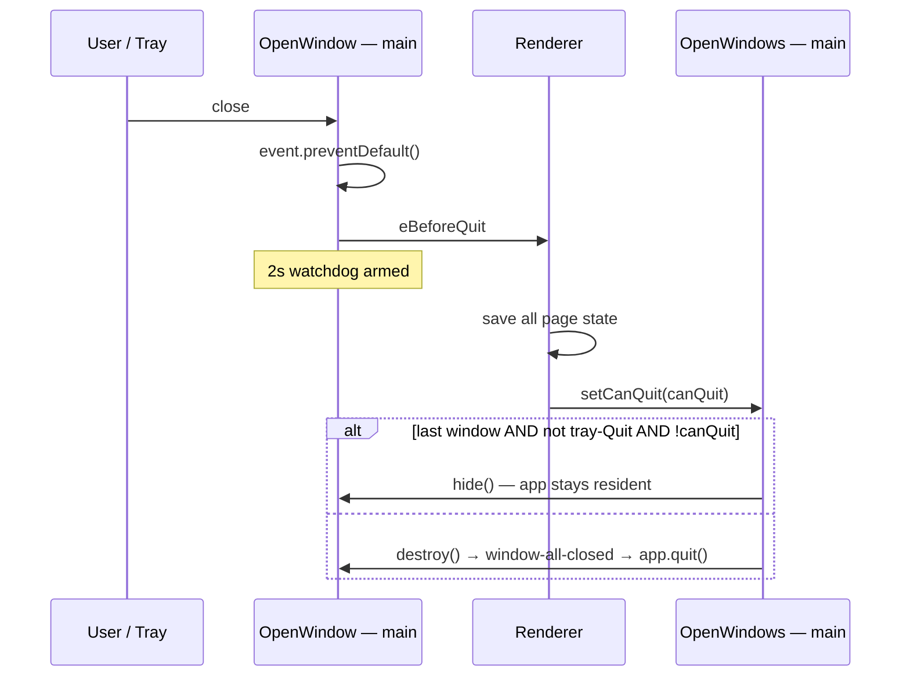

# Pages Architecture

How pages (tabs) work in persephone. Covers the window bootstrap lifecycle,
page lifecycle, action taxonomy, and internal submodel structure.

**Source code:** [`/src/renderer/api/pages/`](../../src/renderer/api/pages/)
**Type declarations:** [`/src/renderer/api/types/pages.d.ts`](../../src/renderer/api/types/pages.d.ts)

---

## 1. Window Bootstrap Lifecycle

Main starts in `src/main.ts`: it parses and applies the optional profile, acquires the single-instance
lock, and calls `setupMainProcess()` from `src/main/main-setup.ts`. The renderer imports locale
startup before loading Monaco NLS, then imports the app, IPC API, and settings in parallel. It loads
the renderer index while `app.init()` and `app.initSetup()` run; after that it initializes app
services, waits for settings, synchronizes board trust, initializes the custom board editor registry,
restores pages, and wires app events. Board-mode windows then open and lock their requested board
page before startup inputs are dispatched.

Bootstrap schedules `api.windowReady()` on a zero-delay timer and returns `renderer/index.ts`'
`mount` callback. `startRenderer()` invokes that callback before the timer fires. The shell and editor
views use native `VanillaView` classes; browser pages own Chromium `<webview>` elements and board
pages host board content in an iframe.



**Layer 1 — Services** (`app.initServices()`): Walks the descriptor table in
`api/app-service-registry.ts` in declaration order. Each descriptor dynamically loads one
service-valued `app.*` member and may provide an `initialize(value)` hook; the current initializer
is `downloads.init()`. Values are installed behind the root app getters, and load/initialize
failures are recorded and reported after the pass so one service does not abort the rest. This
layer includes `capabilities`, whose handlers are seeded from editor capability declarations.

**Layer 2 — Pages** (`app.initPages()`): Restores pages from persistent storage. Saving is suppressed for the whole of the restore. Restore attaches pages one at a time, and each `attachPage` subscribes the page and its editors to the debounced save, so a save that fired mid-restore would serialise an empty or partial page list over the real session — normally harmless because a later save wins, but permanent if the window is closed or reloaded inside that window. `PagesPersistenceModel` gates both the debounced wrapper and `saveState` itself, because some call sites save without the debounce. The gate re-schedules rather than drops, so a suppressed save still runs once restore completes.

The gate tracks *restore in progress* and nothing else, and is released in a `finally`. A persisted page that fails to restore remains as a recovery placeholder with Retry and Close actions, so the original descriptor is retained until the user retries successfully or closes the page. A `schemaVersion` bump still discards every page by design. Persistence must keep working after failures; switching saving off because one descriptor failed would turn a recoverable page into a session that never persists again.

Cold-start inputs are consumed separately by `app.openStartupInputs()` after `app.initEvents()`. Main selects launch operands and parses them into a typed list of file, HTTP(S) URL, and diff inputs. The same parser handles Electron's `second-instance` event and launcher-pipe messages; relative paths use the working directory supplied by each entry point. The renderer dispatches startup inputs through the retained `RendererEventsService` only after the raw-link pipeline is registered. Files and URLs use the normal link pipeline, with launch URLs marked for internal-browser handling; diffs open through the page diff flow. After all inputs are dispatched, the app ensures an empty page exists if needed. The development launcher forwards arguments after `npm start --` to Electron, and all valid cold-start operands are opened in order.

**Layer 3 — Events** (`app.initEvents()`): Initializes 4 internal event services (GlobalEventService, KeyboardService, WindowStateService, RendererEventsService) that subscribe to DOM events and IPC channels, including the raw-link open pipeline.

**Ready signal** (`api.windowReady()`): Tells the main process this window is fully initialized. The main process waits for this before sending IPC events like `eMovePageIn` (page transfer between windows). This is critical for multi-window operations.

**Implementation:** [`/src/renderer.ts`](../../src/renderer.ts), [`/src/renderer/api/app.ts`](../../src/renderer/api/app.ts)

---

## 2. Page/Editor Architecture

**Diagram:** [`diagrams/6-page-architecture.mmd`](diagrams/6-page-architecture.mmd)

Every tab is a `PageModel` — a stable container that owns the browsing context (sidebar, secondary
views) and may contain an `EditorModel` as its main content. The page remains a real tab when its
main editor is absent.

```
PageModel (one per tab — stable identity, never changes during navigation)
├── id: string                          // stable UUID — tab key, cache key
├── state: TOneState<IPageState>        // tab/layout fields and editor membership version
├── restore: PageRestore                // deferred restore attempt, readiness, state, typed retry
├── recovery?: RecoveryPlaceholder      // retained descriptor and cache protection after failed session restore
├── isInert                             // true while a recovery placeholder owns the page
├── mainEditor: EditorOrHost | null     // content host projection; use mainEditorInstance for EditorModel
├── editors: EditorModel[]              // attached editors; panelEditors is the sidebar projection
├── secondaryViewsModel                 // sidebar open/close/width (model lives in api/pages)
├── activePanel: string                 // which panel is expanded
├── releaseEditor(editor, { dispose })  // detach, then optionally dispose
├── promoteToMain(editor)               // toggle an attached editor into or out of the main role
├── assignMain(id)                      // assign persisted main-editor identity during restore
├── findExplorer() / createExplorer()   // ExplorerEditor helpers
├── findEditorByFilePath(path)          // existing editor on this page for a file (navigation reuse)
├── ensurePipeOwner()                   // await renderer ownership before a pipe-backed media session
├── toggleNavigator() / canOpenNavigator() // sidebar toggle (creates Explorer if needed)
├── close()                             // checks unsaved changes, calls onClose
├── dispose()                           // disposes all owned resources
└── saveState() / restoreSidebar()      // persistence

EditorModel (the content inside a page — replaceable during navigation)
├── id: string                          // editor instance identity
├── state: TOneState<IEditorState>      // editor state (content, language, filePath, pipe, etc.)
├── page: PageModel | null              // back-reference to containing page
├── pipe: IContentPipe                  // content source
├── modified: boolean                   // has unsaved changes
├── setPage(page) / onMainEditorChanged() // lifecycle hooks
├── onReopen()                           // optional retry when openFile reuses this page
├── beforeNavigateAway(newEditor)       // secondary survival check
├── survivesNavigation(sourceLink)      // skip save-prompt when editor stays on page
├── keepAliveOnNavigation()             // stay attached with no view (busy Board handle)
├── restore() / dispose()               // editor lifecycle
└── getRestoreData() / applyRestoreData() // serialization
```

**Source:** [`PageModel.ts`](../../src/renderer/api/pages/PageModel.ts), [`PageRestore.ts`](../../src/renderer/api/pages/PageRestore.ts), [`RecoveryPlaceholder.ts`](../../src/renderer/api/pages/RecoveryPlaceholder.ts), [`EditorModel.ts`](../../src/renderer/editors/base/EditorModel.ts)

`PageModel` owns page identity, attached editor membership, the main-editor selection, navigation-related page context,
secondary-view state, and the page descriptor. Restore attempts and failed-session recovery are separate collaborators:
`PageRestore` owns deferred restore status, its `ready` promise, cancellation, attempt identity, the typed Retry
callback, and hooks that run after successful restore; `RecoveryPlaceholder` owns the retained descriptor, retry
coordination, close authorization, and cache-file protection. The page exposes `restore` and optional `recovery`.
`isInert` is true whenever recovery is present; collection, tab, and navigation entry points use that single
predicate to keep a failed-restoration placeholder from being edited, moved, or pinned. Its descriptor remains
available through `recovery.descriptor` and `getDescriptor()` so the placeholder can survive another restart.

There are two distinct retry operations. `PagesLifecycleModel.retryOpen(page, options)` rebuilds content after a
deferred open failed and is installed as `page.restore.retry` for the loading shell. `PagesLifecycleModel.recoverPage`
reconstructs a page from `page.recovery.descriptor` after session restore failed; `RestoreFailedEditor` invokes this
path. The former retries an editor restore on an existing page, while the latter replaces the recovery placeholder.
`PageWrapper.ready` remains the script-facing readiness name and forwards to `page.restore.ready`.

`PageModel`'s attached-editor operations are typed: `releaseEditor(editor, { dispose })` detaches before optionally
disposing, `promoteToMain(editor)` toggles an attached editor into or out of the main role, and `assignMain(id)` sets
the persisted main-editor identity during reconstruction. There is no string-keyed transient store on the page.
Board Run ownership is kept by `BoardPageRouter`; the page retains the typed `lockedBoardRoot` layout field.

`PagesModel.attachPage()` installs the page's media-pipe owner registrar; `detachPage()` and
`PageModel.dispose()` clear it. An editor may ask for ownership while a restored or transferred
page is still being assembled, so `PageModel.ensurePipeOwner()` waits for attachment. It awaits the
renderer registration, retries after a rejected registration, and rejects pending requests if the
page is released. Pipe-backed media sessions must await this readiness before sending a request
with `{ pipe: true, pageId }`; HTTP and local-file sessions do not use this owner guard.

An editorless page is a first-class, session-only tab: `mainEditor` and `mainEditorId` are `null`,
the tab title is `"Empty"`, and the page can still be shown, moved, pinned, grouped, navigated, or
closed. `PageModel.detach(editor)` removes the current main editor and nulls `mainEditorId` while
preserving the page and its sidebar — it deliberately does NOT dispose, so the caller decides
(`ensureBoardIdle` detaches and then disposes); a later `navigatePageTo(pageId, filePath)` can
attach content again.
Consumers that operate on tabs must therefore use the `PageModel` identity rather than treating a
missing main editor as a missing page.

### Pin sides and the right-page popover

`pinSide` is `"left"`, `"right"`, or `undefined`. The `pinned` boolean remains a compatibility
property for a left-pinned tab only; it is derived from `pinSide === "left"`. `pages[]` is ordered
as three contiguous zones: left-pinned, unpinned, then right-pinned. Reordering is allowed within a
zone, and pinning moves a page to the edge of its destination zone. Right-pinned pages are not
members of `ordered[]`, cannot be grouped, closed, or transferred to another window, and
`showPage(id)` opens their popover instead of activating them. Unpinning returns the page to the
normal tab zone and makes it active.

`activePage` continues to mean the page being worked on beneath any popover. `focusedPage` is a
derived interaction target: it is the page currently shown in the right-page popover, or
`activePage` when the popover is closed. Keyboard commands and other operations aimed at the page
receiving user interaction use `focusedPage`; navigation and script/MCP active-page queries retain
`activePage` semantics. The transient `popoverPageId` is window state, while each page's
`popoverSize` is persisted in CSS pixels: the size the user dragged to. It does not follow window resizes; the 80% width and full-height limits only clamp what is drawn, so the chosen size returns when the window grows again. Without a saved size the popover opens at half the page area. Ending a drag within 2% of the maximum height saves `fullHeight: true`: the popover then fills the page area's height and follows window resizes, until a drag makes it shorter again.

The right strip is rendered in the header and clicking its tabs toggles the popover. The popover
uses the existing stable page slot, with CSS geometry and invisible resize strips on its left edge,
bottom edge and bottom-left corner (`PageSlot.ensurePopoverResizeHandles`; the slot clips with
`overflow: clip` plus a clip margin so the strips can straddle the border, and a drag covers the page
area with a transparent shield so a webview under the pointer cannot take the drag); it does not
create a second page view or move the slot, so board iframes and browser webviews keep their live
documents. `PagesView` handles click-away, focus transfer, and Escape dismissal around the host.

Three page concerns live in their own modules rather than in `PageModel`:
[`editor-switch.ts`](../../src/renderer/editors/base/editor-switch.ts) implements the
switch-widget transition (`switchMainEditor` — the page keeps a dynamic-import delegate, so
the board/registry switching machinery stays out of the page model);
[`page-explorer.ts`](../../src/renderer/editors/explorer/page-explorer.ts) provisions the
sidebar Explorer (`toggleNavigator`, auto-init beside a mandatory sidebar — constructing an
`ExplorerEditor` is an editor concern, so it lives beside the editor); and
[`NavBackStack.ts`](../../src/renderer/api/pages/NavBackStack.ts) is the Markdown
back-navigation stack the page owns, mirrors into `navBackCount`, and persists.

The lazy `secondaryViewsModel` uses the cached learned sidebar width only for newly constructed
pages. Session restore and cross-window page transfer construct a restore-mode `PageModel`, so
their persisted sidebar width remains authoritative; a new page keeps the default until its
sidebar is first created. The same boundary applies to duplicated pages, which are fresh page
descriptors rather than restored sidebar state.

### Page lifecycle

- **Created:** `new PageModel()` + `page.mainEditor = editor` + `editor.setPage(page)` (or `mainEditor = null` for empty pages with sidebar only)
- **Initialized:** `editor.restore()` loads content; `page.restoreSidebar()` loads sidebar from cache
- **Deferred restore:** editors may opt in through `deferRestoreOnOpen`. Fresh file opens then add
  the page immediately and start restore asynchronously; `page.restore.ready` settles when that attempt
  completes. Await it before work that depends on restored content. It rejects on restore failure
  or cancellation. Editors that do not opt in preserve restore-before-add behavior.
- **Loading UI:** while `page.restore.state.status` is `loading`, `PageContentView` shows a loading shell with
  pipe stage status. For a fresh deferred open, the tile's close icon cancels its restore; an error
  replaces the loading message with the failure and offers Retry. A persisted page that fails
  restoration instead keeps its tab and descriptor behind `page.recovery`, with Retry and Close
  actions. The intended editor is shown after restore succeeds.
- **Pipe status badge:** while a pipe reports connecting/active work, the editor status bar
  (`EditorStatusBarView`, the footer) shows its status and any known byte progress. Successful reads show a brief completion label; errors remain
  visible until dismissed. Opening the badge's popover shows the provider and transformer stages
  with their current status details.
- **Active/Inactive:** `showPage(pageId)` moves a normal page to the end of `ordered[]`; a
  right-pinned page opens in the popover and remains outside `ordered[]`.
- **Navigation:** `await page.setMainEditor(newEditor)` — full lifecycle swap (beforeNavigateAway, dispose old, notify secondaries)
- **Reopen:** `PagesLifecycleModel.openFile()` shows an existing page and invokes its main editor's optional `onReopen(pipe?)` hook with the newly resolved pipe. The hook returns `true` to take ownership; otherwise the lifecycle disposes the pipe. Editors can use this to retry a failed source without replacing the page.
- **Closed:** `page.close()` → checks unsaved → `onClose()` → `detachPage` → `removePage` → `page.dispose()`

An editorless page that has contributed panels is closed automatically when its composed panel set
transitions from non-empty to empty. The check runs after the current dispatch settles, and is
guarded by both a new main editor and a panel reappearing during that boundary. This is a general
sidebar-only page invariant; an editorless page that never had a panel is not closed by this rule.

### Close flow detail

1. `page.close()` — on PageModel
2. → `confirmSecondaryRelease()` — checks secondary views for unsaved changes
3. → `mainEditor.confirmRelease()` — checks main editor (TextFileModel prompts save dialog)
4. → `onClose()` — set by `attachPage()` in PagesModel
5. → `detachPage(page)` — unsubscribes state listeners, clears `onClose`
6. → `removePage(page)` — removes from `pages[]` and `ordered[]`
7. → `page.dispose()` — disposes secondary views, tree providers, navigator model, then main editor (content pipes, cache files)

For multi-window transfer, `movePageOut()` calls `detachPage()` WITHOUT calling `dispose()`. Cache files survive for the target window.

Plain board pages participate in this same release gate. The board frame reports `modified` state
and registers an asynchronous save callback; close, navigation, editor switch, and explicit board
reload use the normal Save / Don't Save / Cancel prompt. Save failure, rejection, timeout, or Cancel
keeps the page open. The board owns its non-file draft persistence, so window close does not add a
second app-level confirmation protocol.

**Native placeholder rendering:** Pages are hosted by `AppPageManagerView` in
`src/renderer/components/page-manager/`. The native view owns one stable `data-name="page-slot"`
placeholder per page and appends each placeholder directly to its manager root. A page view is
constructed only after its page becomes active (or has been active before), then its root is
mounted directly in the placeholder. `PageSlot` has one native arm, and `PageManagerView` uses the
same native slot contract for browser internal tabs; there is no page-manager React arm. Native
page views dispose synchronously after the placeholder is detached. This prevents iframes,
webviews, and canvas elements from reloading when pages are closed, reordered, grouped, or
ungrouped. Placeholders are never reparented (moved between containers) — grouping is achieved
purely via CSS absolute positioning among siblings in the same container. See `GroupContainer` and
`ImperativeSplitter` in the same folder.
`PageSlot` treats page-view construction and mounting as one rollback scope: if `onMount()`
fails, the partially built view and its registered resources are rolled back before the error is
re-thrown.

**Main editor view keyed by model id:** `PageContentView` owns a `RenderEditorView` for the
current editor model (`src/renderer/ui/app/PageContentView.ts`). Its identity includes the model
instance ID and whether the editor uses the background ornament. Navigating to another model
disposes and recreates the editor view; updates for the same model are forwarded to
`AsyncEditorView`, which loads and mounts the editor module's required native `View`. This keeps
Monaco and other stateful editor bodies from being reused with the wrong model.

`PageContentView` uses `display: contents`, so its `SecondaryViewsView` root and `contentRoot`
are direct flex siblings in the page slot. `Pages.css` does not reorder those children; DOM order
is therefore layout order, with the sidebar before the editor. When a sidebar is created after the
content is already mounted, `PageContentView.sync()` inserts it before `contentRoot`; when there
is no content root yet, the null insertion target retains normal append semantics.

When a state notification retires an editor view, the host root is detached immediately and the
captured view is disposed through `afterDispatch()` after the outermost notification and any nested
updates settle. `PageModel` separately tracks promises for asynchronous editor disposal and awaits
that set during page teardown; the dispatch boundary provides ordering, not completion of async
cleanup. On a close path, the empty-page replacement check likewise runs from the caller after
page disposal has settled.

`PageModel.disposed` is a one-shot subscription that fires at the start of true page disposal,
before editors and secondary views are torn down. Subscribers use it to release page-scoped
requests and other transient ownership; every subscriber must retain and invoke its unsubscribe
function when the request settles. It is distinct from the close event, which can precede a page
that survives navigation.

---

## 3. Page Actions Taxonomy

All page operations are categorized into 5 groups, each handled by a dedicated submodel.

```mermaid
graph TD
    API["IPageCollection<br/>(Public API)"]

    API --> Q["Queries<br/>(Read-Only)"]
    API --> L["Lifecycle<br/>(Create/Destroy)"]
    API --> N["Navigation<br/>(Visibility)"]
    API --> LAY["Layout<br/>(Arrangement)"]
    API --> P["Persistence<br/>(Storage)"]

    Q --> Q1["pages: IPage[]"]
    Q --> Q2["activePage"]
    Q --> Q3["popoverPage"]
    Q --> Q4["find(id)"]
    Q --> Q5["getGrouped(id)"]

    L --> L1["create(type)→IPage"]
    L --> L2["open(path)→Promise"]
    L --> L3["close(id)→Promise"]
    L --> L4["navigate(id, path)"]

    N --> N1["show(id)"]
    N --> N2["showNext()"]
    N --> N3["showPrev()"]

    LAY --> LAY1["move(id, idx)"]
    LAY --> LAY2["pin(id, side)"]
    LAY --> LAY3["unpin(id)"]
    LAY --> LAY4["group(l, r)"]
    LAY --> LAY5["ungroup(id)"]

    P --> P1["restore()→Promise"]
    P --> P2["save()→Promise"]

    style API fill:#e1f5ff
    style Q fill:#f3e5f5
    style L fill:#f3e5f5
    style N fill:#f3e5f5
    style LAY fill:#f3e5f5
    style P fill:#f3e5f5
```



**Public interface:** [`/src/renderer/api/types/pages.d.ts`](../../src/renderer/api/types/pages.d.ts) — `IPageCollection` and `IPageInfo`

Compare mode is a layout state over a grouped pair of text-file pages. The path-based
`openDiff({ firstPath, secondPath })` operation groups the pages and enters compare mode; the
script-facing `pages.compare` node reports active left/right pairs and provides validated
`enter(pageId)` / `exit(pageId)` operations. Its curated compare controls are scoped to the left
page slot, where the compare surface is mounted.

---

## 4. Internal Submodel Architecture

The pages system uses category-based decomposition. `PagesModel` owns shared state, composes five page submodels, and exposes the flat page API. Editor construction, fixed-ID pages, and board-specific routing are separate collaborators so lifecycle code can stay generic.



**Files:**

| Submodel | File | Responsibility |
|----------|------|----------------|
| Base | [`PagesModel.ts`](../../src/renderer/api/pages/PagesModel.ts) | Shared state (`pages[]`, `ordered[]`, `groupings`), core helpers |
| Lifecycle | [`PagesLifecycleModel.ts`](../../src/renderer/api/pages/PagesLifecycleModel.ts) | create and open pages, close pages, navigate, transfer and duplicate pages; invokes generic open interceptors |
| Navigation | [`PagesNavigationModel.ts`](../../src/renderer/api/pages/PagesNavigationModel.ts) | show, showNext, showPrev |
| Layout | [`PagesLayoutModel.ts`](../../src/renderer/api/pages/PagesLayoutModel.ts) | moveTab, pin by side/unpin, group/ungroup |
| Persistence | [`PagesPersistenceModel.ts`](../../src/renderer/api/pages/PagesPersistenceModel.ts) | save/restore window state to disk |
| Query | [`PagesQueryModel.ts`](../../src/renderer/api/pages/PagesQueryModel.ts) | find (by any ID: page, mainEditor, or secondary), findPageByFilePath, activePage, focusedPage, getGrouped, isLastPage |

`PagesModel` owns page-array mutation primitives (`insertPage`, `replacePage`, and `removePage`) so submodels do not directly implement insert, recovery replacement, or removal in the shared arrays. `PagesLayoutModel` owns ordering, grouping, and compare-mode cleanup; persistence owns bulk restore. `PageModel` emits `mainEditorChanged` after editor notifications only when a non-null main editor is selected. `PagesModel.attachPage()` owns the subscription and releases it on detach and shutdown. The layout exits compare mode when the changed page is in an active compare pair and no longer has a text-file host; clearing the main editor does not emit the event.

Editor construction is centralized in [`editor-factory.ts`](../../src/renderer/editors/editor-factory.ts), which supplies the lifecycle and navigation collaborators. Fixed-ID page construction and reuse live in [`standalone-pages.ts`](../../src/renderer/api/pages/standalone-pages.ts). [`BoardPageRouter`](../../src/renderer/api/boards/board-page-router.ts) owns board-specific lookup and open routing and registers with the lifecycle through its generic interceptor interface.

Folder boards are the persistence exception among no-host board pages. Their descriptor keeps the
stable `board-view` editor id but stores the installed `boardRoot` and claimed `folderPath` as
independent durable fields. Restore checks the current trusted custom-editor registry still maps
that board root to the claimed folder before constructing the board; a stale trust or manifest
claim is rejected in favor of a usable Folder View path rather than deriving a folder from the
board installation root. The same folder identity is carried by a host-less Board Info install
page so Download → Register can return to the folder context.

Every persisted Board Info descriptor is restored through the registered `board-info` editor,
whether or not it has a content host or a `folderPath`. The editor applies its durable install,
properties, and file/folder source state, then restores an optional host when present; the generic
host restore path does not own Board Info descriptors.

Bundled-board descriptors use the same durable `boardRoot` field, and restore aliases a stale
installed-resource path to the current bundled root by stable board id only when the old path no
longer has a readable manifest. A readable manifest always wins, preventing a similarly named user
board from being adopted.

Two lifecycle concerns live in their own modules rather than in `PagesLifecycleModel`:
[`PageNavigator.ts`](../../src/renderer/api/pages/PageNavigator.ts) implements `navigatePageTo`
as named steps (the lifecycle keeps a one-line delegate), and
[`browser-pages.ts`](../../src/renderer/editors/browser/browser-pages.ts) implements
`showBrowserPage` / `openUrlInBrowserTab` beside the browser editor — reached via dynamic
import so the startup-loaded pages model never statically imports the browser chunk.

`PagesModel` forwards the composed submodels' public operations. Exported as a singleton:

```typescript
import { pagesModel } from "../api/pages";
```

---

## 5. Internal vs. Public Operations

### Public (in `IPageCollection`, exposed to scripts)

- Queries: `all`, `activePage`, `popoverPage`, `groupedPage`, `compare`, `logView`, `findPage()`, `getGroupedPage()`, `isLastPage()`, `isGrouped()`.
- Lifecycle and openers: `openFile()`, `closePage()`, `openFileWithDialog()`, `navigatePageTo()`, `addEmptyPage()`, `addEditorPage()`, `addDrawPage()`, `openLinks()`, `openDiff()`, `showAboutPage()`, `showSettingsPage()`, `showMcpInspectorPage()`, `showMnemeConfigPage()`, `showToolsHubPage()`, `showBrowserPage()`, and `openUrlInBrowserTab()` (plus `openUrl()`). `openFile(filePath)` accepts files and folders and returns the opened page when the path resolves. A folder produces an editorless page with an Explorer rooted at that folder; because that page has no file path, `PagesModel.openFile()` uses the resolver's ephemeral `ILinkData.openedPageId` to return it.
- Navigation: `showPage()`, `openPopover()`, `closePopover()`, `showNext()`, `showPrevious()`.
- Layout: `moveTab()`, `pinTab(side)`, `unpinTab()`, `group()`, `ungroup()`.

These public method names remain delegates on `PagesModel`; submodel ownership is an implementation detail and does not change the script API.

### Internal (not in .d.ts, private implementation)

- `movePageIn()` / `movePageOut()` — multi-window drag-drop (IPC-driven)
- `attachPage(page)` — subscribes to page state changes for auto-save, sets `onClose` callback that runs the dispose chain (`detachPage` → `removePage` → `dispose`)
- `detachPage(page)` — unsubscribes and clears `onClose` WITHOUT disposing. Used by `movePageOut()` (multi-window transfer) and `navigatePageTo()` to preserve page resources
- `insertPage(page, options?)`, `replacePage(old, recovered)`, and `removePage(page, options?)` — the only page-collection primitives for inserting, recovering/replacing, and removing entries from `pages[]` and `ordered[]`
- `fixGrouping()` — invariant repair
- `checkEmptyPage()` — auto-create empty page when last one closes
- `addEmptyPageWithNavPanel(folderPath)` — creates a PageModel with `mainEditor = null` and an initialized sidebar (Explorer panel). Used by sidebar double-click, archive browsing, the "Open Folder" menu, the "Open Folder" item in the Tools & Editors list, the folder-tree context menu, opening a link that points to a directory, and a folder path arriving from the command line or Explorer's "Open with persephone" folder context menu. The page renders just the sidebar with an empty content area.
- `standalonePages.show(id, options?)` and `standalonePages.requireTextPage(id)` — internal registry operations for fixed-ID pages. The registry handles deduplication, lazy editor construction, and per-page `afterShow` actions; the two MCP log pages use the synchronous text-host accessor.
- `registerOpenInterceptor(interceptor)` — generic lifecycle extension point used by board routing. Interceptors can take an open/navigation request or pass it onward with rewritten options.
- `save()` / `restore()` — persistence (called by bootstrap, not by scripts)
- Submodel instances — private composition detail

---

## 6. Error Handling

```
During restore (initialization):  catch and notify, don't crash
During user actions:              throw, let caller handle
```

- **Restore errors** are isolated so other pages can initialize. Persisted pages keep a recovery placeholder instead of being discarded; retry failures keep the placeholder available. `app.openStartupInputs()` later ensures an empty page exists if no content opened. Cold-start file and URL opens are individually guarded and reported without aborting bootstrap.
- **User action errors** (open file, navigate): the method throws, and the caller (keyboard service, renderer events service, or UI component) catches and shows a notification.

### ID resolution

`PagesQueryModel.findPage(id)` accepts any associated ID — page ID, mainEditor ID, or secondary view ID. All IDs are unique UUIDs, so this is unambiguous. Methods like `getGroupedPage()`, `groupTabs()`, and `isGrouped()` resolve their inputs through `findPage()` first, so callers don't need to worry about which ID type they're passing. This eliminates a class of bugs where code passes editor IDs to methods that internally use page IDs for grouping map lookups.

---

## 7. Multi-Window Page Transfer

When a tab is dragged to another window:

1. **Tab drag** — `PageTab.handleDragEnd()` detects the drop landed outside the window bounds. Sends `PageDragData` to the main process via `api.addDragEvent()`.
2. **Main process** — `DragModel` collects drag events (debounced 100ms) from source and target windows, then calls `movePageToWindow()` in [`open-windows.ts`](../../src/main/open-windows.ts).
3. **Source window** — receives `eMovePageOut` IPC event:
   - `movePageOut(pageId)` calls `page.saveState()` to flush sidebar cache to disk
   - Calls `detachPage()` — unsubscribes but does NOT dispose. **Cache files survive.**
   - Calls `removePage()` — removes from arrays
4. **Target window** — receives `eMovePageIn` IPC event with `PageDescriptor` (main process awaits `whenReady` first):
   - `movePageIn(data)` creates a new PageModel with the **same page ID** from the descriptor
   - Creates an EditorModel from `desc.editor`, calls `applyRestoreData()` and `restore()`
   - If `desc.hasSidebar`, restores sidebar from cache (keyed by page ID) including secondary views

**Why it works:** The `PageDragData` sent by `PageTab.getDragData()` includes a full `PageDescriptor` with `id`, `pinSide`, `modified`, `hasSidebar`, and serialized editor state. Right-pinned pages are excluded from cross-window transfer. Cache files are keyed by page ID. The source window preserves them (no `dispose()`), and the target window reads them using the same ID. Sidebar state (tree expansion, search, secondary view descriptors) is fully reconstructed from cache. The page ID is preserved across the transfer.

**Critical dependency:** The target window must have called `api.windowReady()` before the main process sends `eMovePageIn`. The main process holds a `whenReady` promise per window and awaits it before forwarding events.

**Implementation:** [`/src/main/open-windows.ts`](../../src/main/open-windows.ts) (main process), [`/src/main/drag-model.ts`](../../src/main/drag-model.ts) (debouncing), [`PagesLifecycleModel.ts`](../../src/renderer/api/pages/PagesLifecycleModel.ts) (renderer), [`PageTabView.ts`](../../src/renderer/ui/tabs/PageTabView.ts) (drag handlers)

## 8. Standalone Pages

Fixed-ID standalone page entries use stable persisted IDs, so repeated opens and session restore resolve to the same tab. [`StandalonePages`](../../src/renderer/api/pages/standalone-pages.ts) is the single registry for these entries and for the repeatable video player page. Each entry specifies an editor ID, a text-host configuration, or a custom page builder, and may define an `afterShow` action for both newly created and reused pages. Editor modules remain lazy-loaded; the registry's IDs come from small ID modules rather than loading editor chunks at startup.

Use `standalonePages.show(id, options?)` for fixed-ID editor and custom pages. It reuses the page if present, otherwise creates it within the guarded editor-open path, then runs its optional `afterShow` action. `requireTextPage(id)` synchronously returns or creates the two text-host log pages. Persisted IDs are part of the page descriptor contract and must remain stable.

### Registered standalone page entries

The registry key is shown below; for singleton entries it is also the persisted page ID. The video player uses the same registry builder but intentionally creates a fresh page per open.

| Registry key / persisted ID | Editor or builder | Purpose |
|----|--------------------------|---------|
| `about-page` | `about-view` | About and guides; `atContents` resets the guide browser when requested |
| `settings-page` | `settings-view` | Settings |
| `mneme-config-page` | `mneme-config` | Mneme configuration |
| `storybook-page` | `storybook-view` | Storybook |
| `tools-hub-page` | `tools-hub-view` | Tools & Editors; can select a tab after showing |
| `clipboard-page` | custom Explorer page | Clipboard panel in an editorless page |
| `mcp-ui-log` | `log-view` | MCP Log page — shared by `pages.logView` and script `ui` |
| `mcp-server-log` | `log-view` | MCP server incoming request log; opened from the MCP indicator |
| `video-player` | `video-view` | Repeatable video player page; each open creates a fresh page |

The `pages.logView` collection property is the non-blocking object-model path to `mcp-ui-log`.
It reuses the page's `LogViewEditor` and accepts the same normalized entry forms as script `ui`,
but returns from `push()` immediately with entry and dialog IDs. Inline dialogs remain visible in
Log View for the user to answer; `dialogResult(id)` distinguishes an unresolved dialog from its
resolved entry. Agents use this non-blocking path through `call`.

The About page also owns a runtime guide-browser location. Its left version card remains
stable while the right pane switches between the guide contents tree and a selected guide. Plain
`showAboutPage()` reuses the existing About page and preserves that browser location; the explicit
`showAboutPage({ atContents: true })` entry point resets it to the contents tree. The browser's
guide history and agent-guide filter are runtime state rather than persisted page content. The
`about-view` scripting facade exposes `open`, `back`, `current`, `elements`, and `highlight` for
this fixed page; opening a guide in a tab uses the normal content pipeline.

The Clipboard page is a custom entry in the same registry. It creates an editorless page with an
Explorer host configured with persisted `hideExplorer` and `clipboardOpen`, then expands the
Clipboard panel. Its `afterShow` action opens the panel on both new and reused pages. Closing that
only panel invokes the general editorless sidebar-page auto-close rule described above.

### Fixed-ID page rules

Use this pattern when:
- A page should be a **singleton** (one instance at a time)
- Multiple code paths need to **find the same page** (e.g., MCP handler and ScriptContext both need the same log page)
- The page has a **fixed configuration** (editor, language, title) that callers shouldn't need to know

Do NOT use for:
- User-created pages (scripts, file open) — these should have unique UUIDs
- Pages that can be opened multiple times (browser tabs, text files)

To add a fixed-ID page, add an entry and its stable ID to `standalone-pages.ts` (or a small ID
module when an editor owns that persisted ID), then expose or call the appropriate `PagesModel`
delegate. Do not put fixed-page catalogue logic in the lifecycle model. Registry operations are
internal; public page methods remain the stable interface for UI and script callers.

---

## 9. PageModel — Sidebar and Navigation Context

PageModel is the tab container that owns the sidebar layout (open/close/width via `secondaryViewsModel`), panel selection (`activePanel`), and secondary views. Explorer state (tree provider, selection, search) is owned by `ExplorerEditor` in `secondaryViews[]`. PageModel survives navigation — when the user navigates to a new file, only `page.mainEditor` changes while the PageModel (and its sidebar) stays intact.

**Source:** [`/src/renderer/api/pages/PageModel.ts`](../../src/renderer/api/pages/PageModel.ts)

### Mandatory sidebar and auto-Explorer

`PageModel.sidebarMandatory` is a computed boolean. It is `true` when any secondary view other than the file Explorer is contributing panels. This happens for Link and Archive editors, and for boards that declare secondary views.

When `sidebarMandatory` is `true`:
- `setSecondaryViewsState({ open: false })` is ignored — the close request is silently clamped to `open: true`.
- The sidebar close ✕ button and the toggle affordance are hidden.

This is enforced in `_enforceMandatoryOpen()`, called whenever panel editors attach or detach. It also calls `_maybeAutoInitExplorer()`.

**`_maybeAutoInitExplorer()`** — when the sidebar becomes mandatory and no Explorer exists yet, this method queues a microtask to auto-create an Explorer rooted at the panel editor's file folder (resolved via `_explorerRootForPanels()`). The deferred-microtask design means a persisted Explorer that is re-attached synchronously during session restore is always found by the guard (`findExplorer()` returns it), so no duplicate is created. If the panel editor has no file path (e.g., a new unsaved file), the Explorer is not created.

### Navigation pattern

Board-specific opens are owned by [`BoardPageRouter`](../../src/renderer/api/boards/board-page-router.ts), registered when `PagesModel` is constructed. `PagesLifecycleModel` exposes a generic open-interceptor list; before ordinary `openFile()` deduplication and before `PageNavigator`, it gives interceptors the request. An interceptor can take the request or continue with rewritten options. The router uses this hook for single-instance routing on both open and navigate requests, preserving the established ordering and keeping board rules out of the lifecycle.

For a board whose normalized manifest declares `singleInstance: true`, matching claimed file names (when `singleInstanceMasks` is present) route to one page per renderer window. A matching existing page receives the source URL and optional transient session handle through the editor's typed `acceptOpenContext` hook; the incoming pipe is disposed and navigation does not replace the page selected by the caller. The router also owns bundled-board page creation, capability-handler pages, board Run pages and board-specific page queries. Other requests continue through the normal page lifecycle.

In `navigatePageTo()` ([`PageNavigator.ts`](../../src/renderer/api/pages/PageNavigator.ts) — each step below is a named function there):

```
1. page = findPage(pageId)                    // PageModel stays in arrays
2. survivesNavigation? skip confirmRelease    // else check for unsaved changes
3. reuse a surviving navigation-singleton?    // short-circuit (see below)
4. reuse an editor already open for this file? // short-circuit (see below)
5. ... create newEditor (with sourceLink) ...
6. await page.setMainEditor(newEditor)        // full lifecycle swap (see below)
7. resubscribeEditor(page)                    // re-subscribe for persistence
8. auto-select preview editor (if textFile)
9. onShow / onFocus / saveState
```

**Step 2 — save-prompt gate.** `confirmRelease()` prompts to save unsaved changes, but it fires *before* the page knows whether the old editor will actually be released. An editor that demotes to a sidebar panel instead of being disposed (see Step 6) is not losing anything, so prompting would be spurious. The optional `survivesNavigation(sourceLink)` hook lets the old editor declare it will stay on the page; when it returns `true`, the prompt is skipped. The base implementation returns `false` (prompt as before). `LinkEditor` returns `true` when the editor is modified (a dirty collection survives *any* navigation so unsaved work is never lost) or when the incoming `sourceLink.sourceId` identifies one of its own panel clicks — the same `modified || own-source` predicate that drives its `beforeNavigateAway` / `onMainEditorChanged` panel-survival decision, keeping the gate and the survival outcome consistent. The save prompt still fires on a genuine close, which routes through `confirmRelease()` on a separate path.

**Step 3 — navigation-singleton reuse.** A Pattern B editor that survives navigation (`GitTreeEditorModel` and `MnemeRootEditorModel`) is a **per-page singleton**: navigating *back* to it must reuse the surviving instance, not build a second one (duplicates would pile up as redundant surviving panels). Two optional `EditorModel` hooks express this — declared like the existing optional `hasTextSelection?()`:

- `matchesNavigationTarget?(target, filePath)` — the editor returns `true` when a navigation request names the same logical resource it already represents. `GitTreeEditorModel` matches a `git-tree` target whose decoded `repoRoot` equals its own; `MnemeRootEditorModel` matches a `mneme-root` target whose root folder equals its own (so a *different* Mneme root opens a second instance + panel).
- `onNavigationReuse?()` — called after the reused instance is promoted back to main, so it can refresh data that may have gone stale. `GitTreeEditorModel` calls `refresh()`.

`navigatePageTo()` scans `page.editors` for a `matchesNavigationTarget` hit *before* creating an editor. On a hit it promotes that instance with `setMainEditor` (or just refreshes if it is already main) and returns — no duplicate is created. The hooks are generic; any future survivable singleton editor can opt in without touching the page layer.

A third optional hook, `revealFragment?(fragment)`, follows the same shape for in-document anchors. When the opening link carried a `#fragment` (extracted by the Layer 1 parsers — see [content-pipeline.md](content-pipeline.md)), `navigatePageTo()` and `openFile()` call it on the editor they land on. Unlike the other navigation hints it is applied on **every** exit of both methods, reuse short-circuits included, because an anchor link into an already-open document is still a jump request. `MarkdownEditor` implements it by queueing an `anchor` event on its `ComponentQueue`, which buffers until the view mounts, so the call is safe before the body exists.

**Step 4 — already-open-file reuse.** Independent of the singleton hooks, the page may already hold an editor whose backing file *is* the navigation target — most commonly a modified editor that survived an earlier navigation and now lingers as a sidebar panel (e.g. a dirty `LinkEditor`). Re-selecting that file (an Explorer click on the same path) should restore that very instance, with its unsaved edits and panels, not spawn a second one beside it. `PageModel.findEditorByFilePath(filePath)` finds such an editor — unwrapping text-bearing editors to their content host, where `filePath` lives, so it matches the same property `mainEditor` exposes. `navigatePageTo()` promotes the match back to main with `setMainEditor` and returns; an explicit content-host `target` must still match the existing editor's `editorId`, so "open this file in a different view" is never hijacked. The unused incoming pipe is disposed.

Page lookup compares local-file identities after path normalization, so file URLs and native paths,
slash differences, and drive-letter case do not create duplicate pages. If a navigation request also
contains `revealLine` or `highlightText` and the target is already the main editor's file, the
navigator reuses that editor and applies the requested reveal. It promotes the page to Monaco first
when necessary; it does not rebuild an already-open text model just to reveal a location. The same
behavior is used by `openFile()` and link opens, including board `openRawLink` requests.

Board Run pages use a separate transient ownership path. A board opens a Browser page with
`openRawLink(url, { editor: "browser-view", reuseKey })`; ownership is keyed by the normalized
board root and the board's reuse key, so requests cannot select a user's Browser page or another
board's Run page. Ownership is runtime-only and disappears when the page closes or the app restarts.
The lifecycle creates a fresh Browser page on first use, then navigates that page when the URL
changes or hard-reloads it when the active Browser tab already shows the requested URL. URL
comparison normalizes scheme and host case, and local file URL path case; web URL path and query
case remain significant. Ordinary `openUrlInBrowserTab()` searches skip board-owned Run pages.

**Step 6** — `page.setMainEditor(newEditor)` is the high-level editor swap method on PageModel. It consolidates the lifecycle:
- Calls `oldEditor.beforeNavigateAway(newEditor)` — old editor decides to keep/clear its `secondaryView`
- Checks survival: a panel contributor (`contributesPanels()`) demotes to the sidebar; a `keepAliveOnNavigation()` editor stays attached with **no view at all** — an invisible ownership handle. The one current keep-alive editor is a **busy Board**: its spawned processes must outlive its iframe, so the model stays on the page to tie their lifetime to the page (page close disposes it, which reaps the jobs). Re-navigating to the same board promotes the surviving handle back to main via the `matchesNavigationTarget` singleton reuse (Step 3). A `movePageOut` (cross-window transfer) disposes keep-alive editors — their processes never transfer. Session restore drops a persisted non-main board descriptor entirely (busy is transient; its processes died with the app), so no zombie handle survives a restart.
- Otherwise, disposes the old native view after the replacement is attached
- Sets `newEditor.setPage(page)`, updates `mainEditorId`, and notifies subscribers so the editor view swaps
- Calls `notifyMainEditorChanged()` — secondary views react, cleanup runs
- Registers new editor's secondary panel if it has one

**Note:** The raw `mainEditor` setter (without lifecycle) is still used for low-level operations: persistence restore, `addPage()`, and `dispose()`. `setMainEditor()` is the high-level method for navigation.

**Step 9 — navigation does not steal sidebar focus.** All three exits of `navigatePageTo()` send `onShow` unconditionally but gate `onFocus` on `!isFocusInSidebar()` ([`core/utils/focus-utils.ts`](../../src/renderer/core/utils/focus-utils.ts) — true when `document.activeElement` is inside the secondary-views container). Rationale: `onFocus` drives editor autofocus (the native `TextChromeView` refocuses the page root + `model.focus()`), which is wanted on page *activation* — tab switch, new page — but not on *navigation* driven from a sidebar panel (an Explorer tree click), where the user is still working in the panel (e.g. walking the tree with the keyboard). Activation paths (`showPage`, page-close fallback, the new-tab `openFile` flow) send `onFocus` unconditionally, so keyboard-driven tab switches focus the editor even when the sidebar held focus. Editors with mount-time autofocus (Monaco, Grid) apply the same `isFocusInSidebar()` guard, since a fresh mount happens on navigation too.

**`beforeNavigateAway(newEditor)`** lets the old editor inspect `newEditor.sourceLink` to decide whether to keep itself as a secondary view. The base implementation clears `secondaryView`. Subclasses like ArchiveEditorModel override to check `newEditor.sourceLink?.sourceId === this.id`.

**`notifyMainEditorChanged()`** calls `onMainEditorChanged(newMainEditor)` on each secondary view. Each editor reacts independently: ExplorerEditor clears selection if the new editor wasn't opened from Explorer, ArchiveEditorModel checks if the new main editor was opened from its archive — if not, it clears `secondaryView` and is cleaned up.

### Markdown in-page navigation

The Markdown ("Preview") view navigates **within the current page** when the user clicks a link to a local markdown file, keeps a per-page **back history** so the user can return to the previously-viewed document, and scrolls to `#fragment` anchors.

- **Interception.** `MarkdownBodyView` installs a capture-phase native click listener on its scroll container. A plain left-click on an anchor whose resolved href is a local markdown file — detected by `isLocalMarkdownHref` (`src/renderer/editors/markdown/markdown-nav.ts`: a `file://` URL ending in `.md`/`.markdown`, fragment ignored for the extension test) — is intercepted: the handler pushes the current document onto the page's back stack and dispatches `openRawLink` with `pageId` set (so the pipeline navigates this page in place rather than opening a new tab) and `target: "md-view"` (so the target stays in the rendered Preview). A **same-document** link (a bare `#fragment`) is intercepted too, but only scrolls — it is not a document change, so nothing is pushed onto the back stack and no link event is dispatched. Every other link — non-markdown files, `http(s)`, images, `mailto:` — is left untouched and keeps its normal behavior.
- **History storage.** `PageModel` owns the back stack — a [`NavBackStack`](../../src/renderer/api/pages/NavBackStack.ts) instance behind the `pushNavBack` / `popNavBack` delegates declared on the `IPageHost` contract. It lives on the page, not the editor, so it survives the editor swaps each in-place navigation creates. `IPageState.navBackCount` mirrors the stack depth and drives the Back button's visibility. The stack is **persisted** as `PageDescriptor.navBack` (`NavEntry[]` in [`/src/shared/persistence.ts`](../../src/shared/persistence.ts)) and re-seeded in `PagesPersistenceModel.restorePage` via `seedNavBack`, so history survives app restart and window-to-window transfer.
- **Back.** `MarkdownEditor.navigateBack()` (wired to the Back button in the Markdown toolbar) pops the stack and re-opens that entry in place — going straight through `openRawLink`, so it does not push a new entry. History is not cleared on unrelated in-page navigation; it lives for the page's lifetime.
- **Anchors.** A cross-document anchor arrives as the `fragment` navigation hint and reaches the editor through `revealFragment`, which queues an `anchor` event on the editor's `ComponentQueue`; a same-document one is handled directly by the click interceptor. `MarkdownBodyView` retries the queued scroll command over a short `requestAnimationFrame` ladder while its `MarkdownBlockView` is rendering. Heading ids come from the `rehypeHeadingIds` plugin (sibling of `rehypeHighlight`), which slugs heading text GitHub-style and disambiguates duplicates with `-1`, `-2`; author-supplied ids arriving as raw HTML are never overwritten.
- `BrowserPanelHost` (the other `IPageHost`) implements the back-stack methods as inert no-ops — it has no main-editor navigation.

Anchor resolution is deliberately tolerant, trying three passes in order: the exact id, a case-insensitive id, then the slug of the fragment against the slug of each heading's text. The third pass is what absorbs the difference between anchor dialects — Azure DevOps writes `#rtb.rul.2` for a heading GitHub would slug as `rtbrul2` — since slugifying both sides makes them meet. All queries are scoped to the block's root element rather than `document`, because several Markdown views can be mounted at once and the Minimap additionally clones the rendered content, so ids are not unique document-wide. A fragment that matches nothing leaves the document at the top with no error.

Two timing details matter. The scroll is **synchronous and instant** (not the smooth, microtask-deferred scroll the search uses), because an anchor is a starting position rather than a movement, and because the caller needs the resulting `scrollTop` immediately. `MarkdownBodyView` records that value into its scroll-restore projection: every navigation sends `onFocus` right after `revealFragment`, and the view's scroll-restore would otherwise snap the reader straight back to the top. Since the queued event can also arrive before the native block has committed its DOM, a failed lookup is retried over a short `requestAnimationFrame` ladder before giving up silently.

---

The About guide pane reuses `MarkdownBodyView` through the narrower `MarkdownBodyModel` host
interface, with guide contents supplied by the shared renderer `GuideIndex`. It is not a
`PageModel` or `MarkdownEditor`; its Back action is the guide-browser history, while **Open in
tab** sends the guide's `persephone-guide://` identity through the ordinary Markdown content
pipeline.

## 10. Secondary Editor System

PageModel derives `panelEditors` from attached editors that contribute sidebar panels. This is a major subsystem with its own lifecycle — see the dedicated document for full details.

**Full documentation:** [Secondary Editor System](secondary-views.md)

**Quick summary:**
- Secondary views register by setting `model.secondaryView = ["panel-id"]` — the setter updates state and `PageModel.panelEditors` derives panel contributors from attached editors
- **Pattern A** (separate model): A dedicated EditorModel subclass, e.g., ExplorerEditor
- **Pattern B** (mainEditor as secondary): The mainEditor registers itself in `secondaryViews[]` simultaneously, e.g., ArchiveEditorModel when browsing an archive
- Lifecycle hooks: `beforeNavigateAway()`, `onMainEditorChanged()`, `onPanelExpanded()`
- Header contract: the panel stack owns each header element and passes it to the panel view as `headerHost`
- Persistence: saved as `SecondaryModelDescriptor[]` in sidebar cache, with deduplication for Pattern B

---

## 11. Window Shutdown, Tray, and Quit

Closing a window is a round-trip, not an event. The main process cannot let a window
die until the renderer has flushed its page state to disk, so every close is refused
once and then completed on the renderer's reply.



**The close is always prevented first.** `OpenWindow`'s `close` handler calls
`event.preventDefault()` and sends `eBeforeQuit`; the window is only ever really
disposed of through `OpenWindow.close()` → `win.destroy()`, which bypasses the
`close` event entirely.

**Hiding is what keeps the app alive.** A hidden `BrowserWindow` still counts as
open, so `window-all-closed` does not fire and `app.quit()` is never reached —
which is the whole mechanism behind close-to-tray. Destroying the last window
instead lets `window-all-closed` run, and the `will-quit` handler tears down every
background service (Tor, child commands, board ports, the named pipe, the MCP HTTP
server, the video stream server, Mneme). The `window.close-to-tray` setting is
simply a choice between those two paths.

**Policy rides on the reply, because main cannot read settings.** The main process
never loads `appSettings.json` — settings live in the renderer. Rather than mirror
the value over a second IPC channel and keep it in sync per window, the renderer
resolves it at the moment it answers and sends the decision in `setCanQuit`'s
boolean. Nothing to synchronize, and no startup race: whichever window is closing
has the current value by definition.

**Three guards decide the outcome**, all in `OpenWindows.setCanQuit`:

| Guard | Effect |
|---|---|
| `doQuit` | Set only by tray → Quit; overrides everything so Quit always exits |
| `isLastWindow` | Non-last windows always really close; only the last one can hide |
| `canQuit` | The renderer-resolved `window.close-to-tray` setting |

**An unresponsive renderer force-closes.** If no reply arrives within 2 s the
watchdog calls `OpenWindow.close()` directly, skipping all three guards — so a hung
last window is destroyed and the app quits regardless of the setting. This is
deliberate: hiding a renderer that never answered would leave a frozen window behind
the tray icon, looking like a working background app until the user clicks it.

**Whether a closed window is remembered** is decided in `OpenWindows.windowOnClose`.
A secondary window's persisted state (`openFiles<index>.json`) survives only if some
page is **modified or pinned**; otherwise the file is deleted and the window slot is
dropped. The last window is exempt from the check entirely — its state is always
kept, which is what makes a normal quit restore the session. Remembered windows are
reopenable from the app bar's "Open Tabs" menu.

**Board-mode windows use the same BrowserWindow lifecycle with a separate registry.** They are
not written to `openWindows.json`, do not restore or save normal page-session state, and keep
bounds per board root. Closing a board window always closes it; close-to-tray applies to normal
windows only. A board window is excluded from default external-open routing, while its own pages,
explicit window-index targeting and tab transfers continue to use the combined live-window lookup.
Its locked board page cannot be closed or moved out of the window.

**Implementation:** [`/src/main/open-window.ts`](../../src/main/open-window.ts),
[`/src/main/open-windows.ts`](../../src/main/open-windows.ts),
[`/src/main/tray-setup.ts`](../../src/main/tray-setup.ts),
[`/src/main/window-states.ts`](../../src/main/window-states.ts),
[`/src/renderer/api/window.ts`](../../src/renderer/api/window.ts) (`signalReadyToQuit`)
