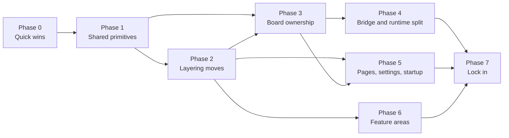

# Persephone refactoring roadmap

**Date:** 2026-11-10 · **Code reviewed at:** `c798129d` (branch `upcoming-v5.0.19`) · **Status:** accepted 2026-11-10.
Phase 0 is [EPIC-141](epics/EPIC-141.md); later phases become epics one at a time.

This roadmap names what should be refactored and how, so that Persephone keeps logic encapsulated in classes and
modules with one clear responsibility each. It combines ten area reviews into one plan, ordered by dependency.

---

## How this was produced

- **Scope:** all of `src/` (about 215k lines of TypeScript in 1,254 files), plus `assets/module-service-host.mjs` and
  `assets/node-script-host.mjs`.
- **Out of scope:**
  - the Rust crates (`mneme/`, `launcher/`, `snip-tool/`)
  - the bundled boards under `assets/boards/`, which are agent-authored
  - build scripts
  - the user guides, except where they drift from the code contract
- **Method:**
  - The code was split into ten areas. Each was reviewed against the architecture documents and coding standards, with
    extra scrutiny for the platform-era code (EPIC-105 to EPIC-140).
  - A static import-graph analysis of the whole tree measured cross-layer imports and import cycles.
  - Every finding cites `path:line`. The highest-impact claims were checked again against the source before going in
    here; these are marked ✓ in [§3](#3-bugs-found-in-passing).
- **Result:** **137 findings**: 35 P1, 76 P2, 26 P3. The detailed area reports are the evidence base for this roadmap.
  Each finding has an ID, its evidence, a target shape, its risks and its ordering notes:

| # | Area | Report | Scope | Findings (P1) |
|---|---|---|---|---|
| 01 | Main process | [01-main](reviews/refactoring-2026-11/01-main.md) | `src/main/**` | 14 (4) |
| 02 | Process boundaries | [02-boundary](reviews/refactoring-2026-11/02-boundary.md) | `src/ipc`, `src/shared`, preload, `board-shim.ts`, module-service host | 14 (4) |
| 03 | Renderer platform services | [03-api-platform](reviews/refactoring-2026-11/03-api-platform.md) | `api/` boards, capabilities, module service, site extensions, mcp, setup | 13 (3) |
| 04 | Renderer core | [04-api-core](reviews/refactoring-2026-11/04-api-core.md) | `app`, pages, settings, fs, `core/`, `content/`, theme | 16 (3) |
| 05 | Board editor | [05-board-editor](reviews/refactoring-2026-11/05-board-editor.md) | `editors/board`, `editors/board-info`, `BoardEditorFacade` | 12 (3) |
| 06 | Browser | [06-browser](reviews/refactoring-2026-11/06-browser.md) | `editors/browser`, `automation/`, `ai-vision/`, `preload-webview` | 14 (4) |
| 07 | Editor framework | [07-editors-core](reviews/refactoring-2026-11/07-editors-core.md) | `editors/base`, `shared`, `text`, `monaco`, `grid`, … | 16 (3) |
| 08 | Tool editors | [08-editors-tools](reviews/refactoring-2026-11/08-editors-tools.md) | settings, link, mcp-inspector, log-view, mneme, … | 13 (4) |
| 09 | UIKit and components | [09-uikit](reviews/refactoring-2026-11/09-uikit.md) | `uikit/`, `components/` | 12 (3) |
| 10 | Shell and scripting | [10-shell-scripting](reviews/refactoring-2026-11/10-shell-scripting.md) | `ui/`, `scripting/` | 13 (4) |

Finding IDs (`MAIN-n`, `BND-n`, `PLAT-n`, `CORE-n`, `BRD-n`, `BRW-n`, `EDC-n`, `EDT-n`, `UIK-n`, `SHL-n`) refer to
those reports. Line numbers drift as the code changes; search by symbol when they stop matching.

---

## 1. Verdict

**The foundations are good. Keep them, and make them the model for everything else:**

- the `VanillaView` lifecycle (`own`, `child`, `listen`, `bind`)
- `TOneState` with `dispatch.ts`, `DisposableStore` and `OwnerScheduler`
- `ContentPipe` and the provider and scheme registries
- the exhaustiveness check in `app-service-registry`
- the editor registration table with literal `import()` rows
- `bindEndpoint` together with the IPC sender guard
- `shared/execute-handle.ts`
- `sidecar-process.ts`
- the av-grid boundary
- the typed `BoardMessageHandlers` table
- the AiVision descriptor registration

Most of the older code follows these patterns.

**The suspicion about the platform work is confirmed, but the cause is not bad individual classes.** The
platform-era classes are readable and heavily commented. The damage comes from accretion. Each epic did four things:

1. It added its **own message names and its own request/reply correlator**.
2. It wrote **another copy of a board rule** (identity, permission, manifest, trust) where the rule was needed.
3. It put its code into the **nearest large class**.
4. It added a **special case at the call site** instead of an extension point.

Nobody owned the cross-cutting concepts, so every feature derived them again. Several of those copies have already
drifted apart, and some of the drift is now a real bug ([§3](#3-bugs-found-in-passing)).

**Health by area:**

| Area | Health | Main problems |
|---|---|---|
| Main process | Mixed | Older services are small and clean. The platform modules are god modules (supervisor, bridge, browser/CDP). Board identity is computed in about 12 different ways. |
| Process boundaries | Poor for platform protocols | Every protocol is hand-paired. One protocol has 6 copies, and the correlator exists 10+ times. `board-shim.ts` is 2.8k lines. |
| Renderer platform services | Poor ownership | No owner for board identity, inventory or lifecycle. There are two capability pipelines. |
| Renderer core | Good foundations, sprawl on top | The page classes absorbed board and recovery features. Each setting is defined in 4–6 places. The layer rules are not true. |
| Board editor | Poor | Two 1.5k+ line classes, split by accident rather than by responsibility. Board editors are constructed outside the board module. |
| Browser | Mixed | The automation core is good. The editor classes have sprawled, and the automation surface is implemented 3 times. |
| Editor framework | Good design, special-cased growth | `base/` is wired to boards. The content-host logic exists in 3 copies. |
| Tool editors | Mostly clean | Settings has no field framework. `LinkEditor` is a god model. Shared contracts live inside editor folders. |
| UIKit and components | Good | The two provider-tree models duplicate each other. Tree expansion is owned twice. |
| Shell and scripting | Good core | `ui/` is used as a service layer. `VoiceTypingController` is a god object. |

---

## 2. Five systemic problems

### 2.1 The board domain has no owner

"What is this board, where did it come from, what is it granted, and how do I stop using it?" has no single answer in
any process.

- **Identity:** the identity rule is written 4 times in the renderer. Main has about 12 path-normalization variants
  and 5 hash schemes. The `local:<sha>` caller id and the root-path namespace disagree.
  (PLAT-1, MAIN-3)
- **Manifest:** main has 5 independent manifest readers. The renderer reader returns `JSON.parse(...) as BoardManifest`.
  The renderer's 1,044-line `board-manifest.ts` lives in `editors/board/`, yet 33 files import it, including `api/` and
  `content/`. (BRD-7, MAIN-3)
- **Permissions:**
  - The legacy-vs-flags rule is re-derived at about 15 renderer sites and 20 main and IPC sites; there are 36
    `kind === "legacy"` hits in total.
  - The renderer copy has **already drifted**: it allows `computerAudio` for legacy grants, while main and `shared/`
    deny it. (BND-5, BRD-6, MAIN-3)
- **Inventory:** main builds the full board snapshot. The renderer throws most of it away and rebuilds it in 4
  consumers, with N+1 IPC calls per trust change. (PLAT-1)
- **Lifecycle:** "stop using a board" means up to six side effects. Seven call sites each pick their own subset.
  "Untrust, then unpin" is copied 6 times. (PLAT-2, SHL-5, BRD-10)
- **Presentation:** board names and glyphs are resolved in 6 shell views, each with its own manifest cache. (SHL-6)

### 2.2 Cross-process protocols are hand-built per feature

- **The windowed-ack service channel** exists in **6 copies**: shim, module-service host, main, renderer capability,
  speech and translation. The copies differ in size checks, ack policy, error codes and early-message buffering.
  (BND-4, PLAT-11, SHL-3)
- **Request/reply correlation** exists in **10+ implementations** with **7 different error envelopes**. (BND-9)
- **The capability error codes** are a 13-code list retyped in **7 places**. A second, 10-code set uses the **same type
  name**, so the shim collapses three codes to `rejected` on one transport but not on the other. (BND-10, MAIN-4,
  CORE-12)
- **Two capability invocation pipelines are both live.** The renderer bus re-implements the deadline, size, cycle and
  outstanding limits that main's router already enforces, with separate counters. Every built-in caller uses the path
  the docs call "legacy". (PLAT-4)
- **The MCP command channel doubles as the main→renderer board-bridge RPC**, with untyped method strings. As a result,
  board calls show up in the MCP request log. (PLAT-5, MAIN-12)
- **The board↔host frame protocol** is about 40 hand-paired message types with no direction typing. **The board↔main
  port RPC** uses positional `args: unknown[]`, and its permissions are keyed on method-name strings. (BND-2, BND-3,
  BRD-11)
- **main↔renderer IPC:**
  - Adding one endpoint takes 5 edits.
  - Event payloads are declared 2–3 times, and the copies have drifted.
  - The preload channel union is silently `any`.
  - There are 6 different channel-definition styles. (BND-7)
- **Port purpose is encoded as a string prefix** (`capability:`, `board-frame:`, `voice-typing:`, `text-translation:`)
  in a field named `boardId`, and parsed with `slice(12)`. (PLAT-5, MAIN-4, SHL-3)

### 2.3 God classes at the platform seams

| File | Lines | What it mixes | Finding |
|---|---:|---|---|
| `src/board-shim.ts` | 2,822 | About 20 jobs. 38 module-level `let`s, 18 `message` listeners, 36 hand-written `postMessage` calls. | BND-1 |
| `editors/board/BoardWebview.ts` | 1,749 | DOM view, per-frame session, 41-message protocol server, 5 pending maps, 5 drifting teardown lists. | BRD-1 |
| `main/module-service-supervisor.ts` | 1,535 | Process lifecycle, trust directory, settings proxy, capability client, MCP issuer, 3 channel brokers. | MAIN-1 |
| `editors/board/BoardEditorModel.ts` | 1,522 | About 12 runtime subsystems (frames, AiVision, source inbox, page state, resources, chrome, …). | BRD-2 |
| `editors/browser/BrowserWebviewModel.ts` | 1,454 | Webview registry, event router, ~600-line site-extension runtime, find, menus, translation, AiVision probing. | BRW-1 |
| `api/pages/PagesLifecycleModel.ts` | 1,444 | Editor factory, board router, fixed-page catalogue, two retry mechanisms, window transfer. | CORE-1 |
| `main/board-bridge.ts` | 1,341 | 30-method RPC table (file IO, watches, dialogs, capabilities), 8 ownerless module maps. | MAIN-2 |
| `components/tree-provider/TreeProviderViewModel.ts` | 1,306 | Loading, file-system/git watch patching, expansion, search, selection, keys, menus, drag-drop. | UIK-1 |
| `main/browser-service.ts`, `main/cdp-service.ts` | 1,305 / 1,287 | One ~370-line `registerWebview` closure. About 20 module maps in CDP. | MAIN-7 |
| `editors/browser/BrowserView.ts` | 1,292 | 12 view classes. Site permissions and the certificate workflow live in the toolbar view. | BRW-5 |
| `automation/operations.ts` | 1,290 | Flat module. Duplicated in-page snippets and dead helpers. | BRW-8 |
| `assets/module-service-host.mjs` | 1,251 | Untyped `.mjs` that copies the TS contract by hand. 6 jobs. | BND-6 |
| `editors/link-editor/LinkEditor.ts` | 1,130 | Lifecycle, link-collection domain, import and UI orchestration. Its rules are copied into the tree provider and 3 views. | EDT-5 |
| `api/pages/PageModel.ts` | 1,061 | Tab container, restore state machine, recovery placeholder, board ownership, `any` shims. | CORE-2 |
| `ipc/main/core-handlers.ts` | 899 | Business logic in the IPC layer (shortcuts, display moves, capability invoke). | BND-8 |
| `editors/settings/sections/SettingsSections.ts` | 912 | 18 hand-written sections with no field framework. | EDT-1 |
| `editors/content-host/TextFileModel.ts` (`TextFileModel`) | 481 | IO, script panel with a raw Monaco reference, shortcuts, script running, navigation. Moved from the misnamed `editors/text/` folder in US-1885. | EDC-3 |
| `ui/voice-typing/VoiceTypingController.ts` | 615 | IPC, settings, protocol parsing, audio capture, text reconciliation and an auto-stop heuristic. | SHL-2 |

### 2.4 The documented layer rules are not true

`doc/architecture/overview.md` ("Dependency Rules") describes a clean stack. The import graph does not match it.

Static runtime imports in the wrong direction:

| Edge | Imports | Main cause |
|---|---:|---|
| `api` → `editors` | 47 | Board domain modules live in `editors/board/`. `api/` also uses editor models as file IO. |
| `api` → `ui` | 11 | Dialogs, secondary-view state, speech types, editor categories |
| `content` → `editors` | 9 | The file→editor resolver is owned by the board registry. |
| `components` → `editors` / `ui` | 6 / 7 | Board icons, `pipe-status`, dialog buttons |
| `core` → `api` / `ipc` | 7 / 1 | `utils.ts` (clipboard IPC), `guard.ts`, file watchers. As a result, every `TOneState` user loads the IPC module. |
| `uikit` → `editors` | 1 | `ImageViewportView` → `image-export`, which forms an import cycle |

Outside `ui/`, **96 files import from `ui/`**, 13 of them in `api/`.

There are **5 static import cycles**:
- a 27-file cycle in main (MCP ↔ services)
- a 19-file cycle across `api`, `editors` and `scripting` (`capability-bus` ↔ `PagesLifecycleModel` ↔
  `TextEditorModel` ↔ `ScriptRunner` …)
- a 6-file cycle in the browser editor
- a 2-file cycle in `content`
- a 2-file cycle in the dialogs

Many more cycles are hidden behind `await import(...)` calls that exist only to dodge them.
(CORE-3, SHL-1, PLAT-3, BRD-8, EDT-7, UIK-7, UIK-8, EDC-2, EDC-15)

### 2.5 One job, many patterns

- **Startup:**
  - The renderer starts its services from 8 places.
  - Main has 4 service shapes and 5 start-up styles.
  - Main also has a hand-kept 12-call shutdown list.
  - Two main modules bypass the documented IPC sender guard.

  (PLAT-6, CORE-8, MAIN-6, BND-14)
- **Mirroring:** main-owned state is mirrored into the renderer in 6 different ways, each with its own stale-snapshot
  guard. Agent-tool trust is a third trust model and is not synchronized across windows. (PLAT-7)
- **Settings:**
  - Each key is defined in 4–6 places.
  - Side effects are applied twice in `app.ts`, once at startup and once on change.
  - There are 39 hand-filtered `onChanged` subscribers.
  - The Settings views restate the value rules, and one rule already disagrees with the service.

  (CORE-7, EDT-3)
- **Persistence:** main persists JSON state in 5 different ways. Two trust stores contain byte-identical atomic-write
  code. (MAIN-11)
- **Facades:**
  - The AiVision skeleton is copied 22 times.
  - The automation surface is implemented 3 times, across the browser, board and `window.screen`.
  - Several facades hold model logic.

  (SHL-9, SHL-10, BRW-3, BRW-2, BRD-5)

---

## 3. Bugs found in passing

These were not hunted for. They came up while reviewing, and most of them are a direct result of the duplication
described above. Each is a small fix that can be made now, independent of the refactoring. ✓ means the claim was
re-checked against the source while this roadmap was written.

| # | Bug | Where | Finding |
|---|---|---|---|
| 1 ✓ | The renderer's `boardTrust.allows` allows `computerAudio` for legacy grants, while main and `shared/` deny it. Latent: no caller asks yet. | `api/board-trust.ts:144` vs `shared/board-manifest-utils.ts:139` | PLAT-1, BND-5 |
| 2 ✓ | Page summaries report the previous browser URL after a link navigation (the stale `state.url` mirror). | `scripting/api-wrapper/PageWrapper.ts:366` | BRW-4 |
| 3 | A Tor page reads `tor.bookmarks-file`, but a newly chosen bookmarks file is saved to the default profile. | `BrowserTabsModel.ts:61` vs `BrowserBookmarksUIModel.ts:108-128` | BRW-9 |
| 4 | When `showBrowserPage` refuses to open a page, the half-built editor is not disposed, so its subscriptions and timers keep running. | `editors/browser/browser-pages.ts:94,104` | BRW-10 |
| 5 | Query methods (`getText`, `getValue`, `exists`, `waitFor`, …) use first-match `querySelector`, so `text=` locators throw. This also contradicts the documented locator contract. | `automation/operations.ts:1033-1095` | BRW-8 |
| 6 | Every speech `describe` port reaches two routers. The router that does not claim the port keeps it until the window closes. | `ui/voice-typing/VoiceTypingController.ts` (pending ports) | SHL-3 |
| 7 ✓ | After the Script Library folder is changed, `.js` files in the new folder are not transpiled until restart, because the first path is kept. | `scripting/library-require.ts:37-41` | SHL-11 |
| 8 ✓ | `--profile` windows show the default profile's theme, custom themes and UI language at first paint, because the data folder is hard-coded. | `theme/themes/index.ts:33,111`, `i18n/startup.ts:49,79` | CORE-9 |
| 9 | `languages.english()` returns no translator notes for the `voiceTyping`, `transcript` and `translation` areas, because its hand-kept list has 18 areas and the real one has 21. | `api/languages.ts:87-106` | CORE-10 |
| 10 ✓ | The MCP guide mounts parse `trustedBoards.json` directly instead of asking the trust service, so a disabled bundled board still mounts its guides. | `main/mcp/ai-vision/board-guide-mounts.ts` | MAIN-3 |
| 11 | On the frame route, capability replies with `permission-denied`, `channel-backpressure` or `channel-closed` become `rejected`. The port route passes the codes through. | `src/board-shim.ts:1058` | BND-10 |
| 12 | Only four gated board request types get a "not permitted" reply. Every other gated request is ignored, and the board waits for its own timeout. | `editors/board/BoardWebview.ts:450-458` | BRD-1 |
| 13 ✓ | The preload facade's channel union is effectively `any`: it references the renamed `PreloadEvent`, and `skipLibCheck` hides the error. | `renderer/types/window.d.ts:16` | BND-7 |
| 14 | The renderer's `eBoardNotify` payload type lacks `persistent`. | `ipc/renderer/renderer-events.ts:161-164` | BND-7 |
| 15 | The microphone notch range disagrees: the service accepts 20–20000 Hz, the Settings field allows 20–7999 Hz. | `api/settings.ts:251` vs `SettingsSections.ts:880` | EDT-3 |
| 16 | The Theme section detects a missing theme editor by comparing two separately stored English strings. Editing either one breaks the "open Tools hub" path. | `editors/settings/sections/ThemeSection.ts:301-302` | EDT-2 |
| 17 | Tree repaint signatures disagree, so changing `getName` alone repaints nothing. Href comparisons mix case-sensitive and case-insensitive checks, so a selected row can be left out of plural menus and drags. | `uikit/Tree/TreeModel.ts:233-245,910`; `TreeProviderViewModel.ts:1011,1093` | UIK-5, UIK-3 |
| 18 | `options.sourceLink` is read although `options` is optional. Latent; it compiles only because `strictNullChecks` is off. | `api/pages/PagesLifecycleModel.ts:735` | CORE-4 |
| 19 | Two main modules register raw `ipcMain` handlers, bypassing the documented sender guard. | `main/board-dialog-service.ts:69-73`, `main/audio-service.ts` | MAIN-6 |
| 20 | The published guide says "bridge 1.49.0" while the constant is 1.54.0. The board template `CLAUDE.md` stops at 1.48.0. | `assets/guides/agents/boards.md:14`, `assets/board-template/CLAUDE.md` | BND-11 |
| 21 | Agent-facing text is mojibake (`→`), and several UI strings bypass `t()`: "Ungroup", "Close Page", "Mute Page", "No content", "Reset", the menu-bar tooltips. | `settings-catalog.ts:242`; `PageTabView.ts:352,413,433`; `MenuBarView.ts:325-327`; … | EDT-13, SHL-4, SHL-8 |

---

## 4. Target architecture: what "done" looks like

### 4.1 Layer map (renderer)

```
shared/        pure contracts and rules used by main, renderer and the board shim (no IO)
core/          state primitives and pure utilities (no api/, no ipc/)
uikit/         standalone components (core/ and theme/ only)
api/           object model and services: fs, settings, pages, boards/, capabilities/,
               speech/, translation/, dialogs (models), mcp client, editor categories
content/       link pipeline. Layer 2 classifies; Layer 3 executes actions.
components/    Persephone-coupled views (api/, uikit/)
editors/       editor models and views. base/ never imports a specific editor.
scripting/     runners, facades, AiVision
ui/            shell views only. Nothing outside ui/ imports ui/.
```

Key decisions behind the map:

- **No new top-level layer.** `api/` is the service layer. Speech, translation, dialogs, editor categories and the board
  domain move *into* it, out of `ui/` and `editors/`.
- **Enforcement:** add `eslint-plugin-import` `no-restricted-paths` zones that mirror the map.
  - Start them as warnings that list today's exceptions, and tighten them as each phase lands.
  - Then rewrite `overview.md` "Dependency Rules" so it states the enforced map.
  - This is a lint rule, not a test.
- **Main process:**
  - A service is a class with `start()` and `dispose()`.
  - Only `src/ipc/main/*` registers IPC (named sender policies, no raw `ipcMain`).
  - Contracts live in `src/ipc/` and `src/shared/`.
  - Services are built and disposed in dependency order in `main-setup`.

### 4.2 Board domain

- **`src/shared/board/`**, pure and shared by main, renderer and shim:
  - the manifest schema and `parseBoardManifest`
  - a **`BoardGrant`** value object: `allows(flag)`, `fileSystemMode()`, `networkPolicy()`, `canRunService()`,
    `iframeFeatures()`, `deny(flag)`
  - a **`BoardRoot`** identity: `.key`, `.storageKey`, `.host`, `.windowKey`, `.localCallerId`, `.bundledId`, each
    **byte-identical** to today's algorithm
  - page-state validation
  - path comparison
- **Main:**
  - `board-identity.ts`
  - a cached `board-manifest-reader.ts`
  - `bundled-boards.ts`
  - `BoardTrustService`, split into a store, a snapshot builder and a service with `onSnapshot` subscribers
  - `BoardFileAccessService`
  - `BoardFrameRegistry`
  - `board-host/` holding a `BoardBridgeConnection` per port and RPC handlers split by domain, each with a declared
    permission
- **Renderer, `api/boards/`:**
  - **`BoardRegistry`:** one mirror of main's snapshot, answering "what boards exist, where from, what identity, what
    grant".
  - **`BoardLifecycle`:** unregister, delete, uninstall, rename, install a version and ensure idle, as one ordered
    sequence.
  - board access and trust consent.
  - the **board contribution registry**, which is today's `customEditorRegistry`, renamed and split per axis, with
    `findByRoot`.
  - one board display/identity service.
  - manifest IO.
- **`EditorCategoriesModel` (`api/`)** prunes board refs when trust is removed. The six manual "unpin after untrust"
  calls disappear.
- **`editors/board/`** keeps only the editor models and their factory, the views, the frame session and the bridge
  handler modules.

### 4.3 Protocol primitives

Each of these exists once:

- **`shared/service-channel.ts`** replaces the 6 copies, with adapters for DOM and Electron ports.
- **`shared/pending-requests.ts`** plus one wire error shape `{ code, message }`, with `toWireError` / `fromWireError`.
- **`shared/capability-contract.ts`** holds `CAPABILITY_ERROR_CODES` and `PLATFORM_CAPABILITY_IDS` exactly once.
- **`shared/serial-queue.ts`, `shared/coded-error.ts`** and one path-containment helper.
- **A typed main→renderer RPC** (`ipc/renderer-rpc.ts` plus `main/renderer-rpc.ts`). MCP `call` becomes one client of
  it, and the board-bridge methods move off the MCP channel.
- **`ipc/board-bridge/`**, split into `boot`, `port-protocol`, `frame-protocol`, `ui-catalog` and `origin-routes`, with
  `req`/`res`/`evt` envelopes and per-direction method maps.
- **IPC contracts per domain**, bound with `bindDomain<XApi>()` (enforced per domain by the compiler), plus a generated
  renderer client with a default timeout and typed event sends.
- **A bridge history table** from which `BOARD_BRIDGE_VERSION` is derived.

### 4.4 One capability pipeline

```
renderer / board / service caller
  → main CapabilityClient (one per caller owner)
  → CapabilityRouter
  → CapabilityBackend ("board-service" | "audio")
```

The renderer bus loses its limit enforcement. `capabilities.ts` splits into a client, the built-in open handlers and
an open-dispatch server. The `mainOwnedAudio` branches and their dynamic imports go away. (PLAT-4, MAIN-4)

### 4.5 Conventions

| Job | One way |
|---|---|
| Renderer startup | An ordered phase table (`services` / `before-pages` / `events` / `deferred`), extending `app-service-registry` |
| Main services | A class with `start()` and `dispose()`, constructor-injected collaborators, reverse-order shutdown |
| Settings | A schema table (default, comment, normalize, options, range) + `settings.watch(key)` + a settings-effects table |
| Main-owned state in the renderer | A `MainSnapshotMirror` base class |
| JSON persistence in main | `JsonFileStore<T>` (atomic, serialized, validated) |
| Facades | `EditorFacadeBase` + a facade registry + `AutomationSurface`. Facades hold no model logic. |
| Content host | A `ContentHostSlot`, composed rather than inherited |
| Editor resolution and switching | An `EditorCatalog` with sources + registered switch strategies + one matcher contract |
| Single-editor hooks | Traits on the existing `TraitSet`, not optional members on `EditorModel` |

---

## 5. Roadmap

Every item below is sized to become an epic or a task. The **Findings** column lists the IDs whose report sections
hold the detailed plan. Effort is S (under a day), M (1–3 days) or L (more than 3 days).



Phase 6 items can run in parallel with Phases 4–5 once their own dependencies are met.

### Phase 0: Quick wins (start now; each item is independent)

| Item | What | Findings | Effort |
|---|---|---|---|
| 0.1 | Fix the bugs in [§3](#3-bugs-found-in-passing). Each is a one-place fix; #1 is one line. | see §3 | S each |
| 0.2 | **Dead-code sweep.** See the list below. | MAIN-13, BND-8, BND-10, BRD-12, CORE-6, CORE-13, EDC-3, EDC-5, EDC-16, EDT-13, UIK-10, SHL-13, BRW-7, BRW-8 | S–M |
| 0.3 | **Single sources for duplicated constants and small helpers.** See the list below. | BND-10, BND-12, BND-13, MAIN-12, CORE-10, CORE-12, BRW-11, BRD-11, EDC-13, PLAT-8, EDT-10 | S each |
| 0.4 | **Doc and comment drift.** See the list below. | BND-11, BRW-14, CORE-16, EDC-16, SHL-13, UIK cross-area | S–M |

**0.2 dead code:**
- `src/ipc/main/registry-handler.ts` (✓ no importers) and the empty `src/main/main.ts`
- `board-usage-cache.ts` and `board-service-permission.ts`
- `board-api.d.ts`, if [D4](#6-decisions-for-you) is accepted
- the `editors/index.ts` barrel and `editors/types.ts`
- in `core/`: `obj-path`, `memorize`, `audio`, the unused utils and three barrels
- the UIKit barrels and the `version`/`getVersion` counters
- the dead pin API in `pinned-items.ts`
- the `operations.ts` tab helpers
- `openFileAsArchive*`, `handleOpenUrl`, the dead `PagesModel` delegates and `onAppQuit`
- `ScriptRunner.run`
- `detectedContentEditor` and its 2.5 s timer
- `resolveForFile` and `AcceptanceInput.mode`
- `TextFileModel.canClose`/`getRestoreData`
- the unused `PageModel` shims
- `IntentSettlement`
- the React-era alias exports
- the unused translation detection-sample pipeline
- the Notebook `.note.json` icon mapping

**0.3 single sources:**
- `CAPABILITY_ERROR_CODES` and the platform capability ids
- the audio-window channel names, moved into `ipc/audio-channels.ts`
- the host-service `boardId` prefixes, moved into `ipc/module-service-channels.ts`
- the browser zoom bounds
- page-state validation
- `englishEntryCatalogs`
- the text codec (`fs.ts` vs `content/encoding.ts`)
- `decodeFolderEditorLink`
- the recording file-name pattern
- site-extension id and host validation
- the board network guard
- the i18n formatter and the board host-text catalog
- `fpNormalizeForCompare` instead of hand-written normalizers

**0.4 doc and comment drift:**
- `overview.md`: the shim is called "small", the bootstrap sequence is outdated, the dependency rules (mark them as
  target rules until Phase 2), and trust inheritance
- `browser-editor.md` still has React-era text
- `pages-architecture.md`, `scripting.md`, `folder-structure.md`, `editors.md` and `model-view-pattern.md`
- the bridge version stated in the guides
- about 100 planning-ID comments and "Walkthrough NN" tags (replace each with a one-line *why*)
- React-era comments

### Phase 1: Shared primitives (enablers; small, and they unblock the rest)

| Item | What | Findings | Effort |
|---|---|---|---|
| 1.1 | `PendingRequests` + one wire error shape | BND-9 (steps 1–2) | S |
| 1.2 | `shared/service-channel.ts` replacing the 6 copies. One host-service port router. A typed `ServiceChannelTarget` union instead of `boardId` prefixes. | BND-4, PLAT-11, SHL-3, PLAT-5 (step 3), MAIN-4 (step 4) | M |
| 1.3 | `SerialQueue`, `codedError`, path containment, `onWebContentsGone` | PLAT-11, MAIN-4 (step 5) | S |
| 1.4 | Shared board core: move the manifest schema and parse into `shared/board/`, add `BoardGrant` and `BoardRoot`, delete the inline permission copies | PLAT-1 (step 1), BND-5, BRD-6, BRD-7 (split), MAIN-3 | M |
| 1.5 | `JsonFileStore` in main; migrate both trust stores first | MAIN-11 | M |
| 1.6 | Typed main→renderer RPC, separated from MCP. Board-bridge methods move off the MCP channel and out of the MCP request log. | PLAT-5, BND-9 (step 3), MAIN-12 | M |

### Phase 2: Layering (mostly pure moves, one move-only commit each)

| Item | What | Findings | Effort |
|---|---|---|---|
| 2.1 | Move the board domain into `api/boards/`: manifest IO, bundled registry, access, trust consent, busy boards, display text, pipe server (to `content/`), contribution registry | BRD-8, PLAT-3 (slices 1, 5–7), EDC-13 (step 4) | M |
| 2.2 | Make `ui/` a pure view layer: `SecondaryViewsModel`/`panel-key` go to `api/pages`; dialog models and `DialogButton` to `api/dialogs`; speech and translation services to `api/speech` and `api/translation`; the DSP classes to `renderer/audio/dsp`; editor categories to `api/`; transcript and translate contributions to `editors/monaco/contributions` | SHL-1, SHL-5, CORE-12 | L (one folder at a time) |
| 2.3 | `core/` cleanup: `resolveState` into `core/state`, `toClipboard` out, an injected guard reporter, file services to `api/`, trait registrations at bootstrap. Move the content menus out of `content/`. | CORE-3 (steps 1–5) | M |
| 2.4 | Move contracts out of editor folders: `McpConnectionManager`, `mnemeTypes`, `logTypes`, the link list/tiles views, `storyTypes`, the tools tree. Reshuffle `editors/shared/`. Make UIKit standalone (`ImageViewport` `onCopyImage`, raster code into `core/`). Fix the `components/` boundary (`pipe-status`, icon registration). Move the Monaco setup out of `api/`. | EDT-7, EDC-15, EDC-8 (step 3), UIK-7, UIK-8, PLAT-3 (slice 4) | M |
| 2.5 | ESLint import zones (warnings), including "`editors/base/**` must not import board modules" | CORE-3 (step 8), EDC-2 (step 4) | S |

### Phase 3: Board platform ownership (highest value; P1 core)

| Item | What | Findings | Effort |
|---|---|---|---|
| 3.1 | Main: one board identity, manifest reader and bundled-board list. The trust snapshot gets subscribers, `getPermissionGrants()` becomes a pure read, and `BoardFileAccessService` is added. | MAIN-3, MAIN-5 | M + M |
| 3.2 | Renderer `BoardRegistry` fed by one main snapshot broadcast, built on a `MainSnapshotMirror` base. Port site-extension trust, published boards, module-service status and the capability index to the same base. | PLAT-1, PLAT-7, PLAT-10 | L |
| 3.3 | `BoardLifecycle` for all seven entry points. Board Info's "remove" and "install version" flows. Category pruning on trust removal. | PLAT-2, BRD-10, SHL-5 | M |
| 3.4 | One capability pipeline: renderer invoke goes through main's router, plus `CapabilityClient` and `CapabilityBackend` in main | PLAT-4, MAIN-4 | L |
| 3.5 | Board-editor factory, `findByRoot` (removes 14–15 linear scans), the editor kind captured once, a stream-host subclass | BRD-3 | M |

### Phase 4: Board bridge and runtime decomposition

| Item | What | Findings | Effort |
|---|---|---|---|
| 4.1 | Frame protocol envelopes and method maps; the shim's `HostFrameChannel` and the renderer's `BoardFrameEndpoint` | BND-2, BRD-11 | M |
| 4.2 | Split `BoardWebview`: `BoardFrameSession` with one `retire(reason)` teardown, `BoardHostRouter` with feature handler modules, a thin view. Extract `BoardEditorModel` collaborators (frame registry first), `BoardFrameChrome` and `BoardAiVisionChannel`. | BRD-1, BRD-2, BRD-4, BRD-5 | L (several tasks) |
| 4.3 | Typed port RPC with declarative permission. Split main `board-bridge.ts` (`BoardFrameRegistry`, per-port `BoardBridgeConnection`, RPC modules by domain, `BoardFileAuthorizer`). | BND-3, MAIN-2 | L |
| 4.4 | Split `board-shim.ts` into `src/board-shim/` modules behind a thin composition root. The `window.persephone` surface must stay byte-identical. | BND-1, BND-12 | L |
| 4.5 | Move the module-service host to TypeScript and build it like the shim. Split the supervisor (adapters → trust directory → channel broker → process object). | BND-6, MAIN-1 | L |
| 4.6 | `ContentHostSlot`: one composable content-host implementation for text editors, Grid and both board models | EDC-1, BRD-9 | M |

### Phase 5: Pages, settings, startup and app conventions

| Item | What | Findings | Effort |
|---|---|---|---|
| 5.1 | Split `PagesLifecycleModel`: editor factory → board page router (open interceptor) → standalone-pages registry → `PagesModel` mutation primitives | CORE-1 | L (4 tasks) |
| 5.2 | `PageModel`: `PageRestore`, `RecoveryPlaceholder` with one `isInert` guard, typed runtime slots instead of string transients, typed members instead of `any` shims, no `ui/` imports | CORE-2 (steps 1–5, 7) | L |
| 5.3 | A `PageOpenRequest` with one `applyOpenHints`; editor-module `restoreFromDescriptor` hooks and descriptor migrations; one `PagesModel` surface | CORE-4, CORE-5, CORE-6 | M + M + S |
| 5.4 | Finish the host migration: remove `EditorOrHost`, `unwrapToHost` and `state.type`; canonical getters on `EditorModel`; `TextFileModel` moved and slimmed (one keymap, script running in `scripting/`, navigation through the editor) | CORE-2 (step 6), EDC-3, EDC-4 | L |
| 5.5 | Settings schema, `settings.watch`, the effects table and the `appSettings` vs `uiPreferences` rule. The renderer startup phase table. A startup environment that resolves the profile data folder; `CustomThemeCatalog` and `ThemeService`. | CORE-7, EDT-3, CORE-8, PLAT-6, BND-14, CORE-9 | M + S + S |
| 5.6 | Main conventions: one service shape, IPC only in `ipc/main`, named sender policies. Move the business logic out of `core-handlers`. IPC contracts by domain with a generated client. | MAIN-6, BND-8, BND-7 | M + M + M |
| 5.7 | Content Layer 2 records a typed `action`; Layer 3 executes it, so the `phase` guards go away | CORE-11 | M |

### Phase 6: Feature areas (parallelizable; each line is its own epic)

| Item | What | Findings |
|---|---|---|
| 6.1 | **Browser:** extract `BrowserSiteExtensionController`, `BrowserPageRemote`, `BrowserFindModel` and `BrowserSitePermissionsModel`. Tab state without mirrors. Split `BrowserView`. A typed guest message protocol and a preload split. One translation owner. Bookmarks ownership. `BrowserEditor.createNew`. Main side: `BrowserGuest`, `CdpTarget`. | BRW-1, 2, 4, 5, 6, 7, 9, 10, 11, 12; MAIN-7 |
| 6.2 | **Automation and facades:** one `AutomationSurface`; split `operations.ts` and narrow the target interfaces; `EditorFacadeBase` + facade registry; facades stop re-implementing model rules; one log-entry normalizer | BRW-3, BRW-8, SHL-9, SHL-10, SHL-12 |
| 6.3 | **Voice and speech:** `SpeechSessionClient`, `MicrophoneCapture`, `LiveTextInserter`, `SpeechAutoStop` and an app-level `VoiceTypingService`. A slim `TranscriptController`. Split the audio window (`CaptureSourcePool`, `PlaybackChannel`). Main: a `VoiceTypingController` out of `OpenWindow`; `OneShotFrameGrant` media grants. | SHL-2, CORE-12, MAIN-8, MAIN-9 |
| 6.4 | **Editor framework:** `EditorCatalog` with sources and switch strategies (`base/` no longer knows boards); one matcher contract and typed editor ids; a slimmer `EditorModel` with traits and a typed queue; typed `EditorModule<M>` with a shared text page view; shared image actions; panel views without IO; `ExplorerEditor` split into panel editors; a tree-provider host trait; a source-watch helper; `VideoStreamSession`; grid codecs | EDC-2, 5, 6, 7, 8, 9, 10, 11, 12, 13, 14 |
| 6.5 | **Settings editor:** field kit + `SettingsStore` adapters (board settings reuse it); sections call the owning services (`languages`, `themes`, a new `browser-profiles` service, a microphone service); `SettingsLayoutModel` + `ScrollSpy` | EDT-1, EDT-2, EDT-4 |
| 6.6 | **Tool editors:** `LinkCollection` + `LinkImporter` and the de-duplicated link views; MCP inspector `McpSession` + per-area sub-models; a log-entry type registry + `JsonlLogDocument`; a typed Mneme client; a published-boards entry list for the Tools hub | EDT-5, 6, 8, 9, 10, 11, 12 |
| 6.7 | **Tree and UIKit:** `ProviderItemController` (UIK-3) → controlled tree expansion with a single lazy-load owner (UIK-2) → `TreeProviderViewModel` split (UIK-1). Then the pooled-row host and repaint tracker (UIK-4, UIK-5), the shared list filter and navigation (UIK-6) and the cleanups (UIK-9 to UIK-12). | UIK-1 to UIK-12 |
| 6.8 | **Shell and scripting:** a `PageTabState` projection on the page model, `EditorModel.displayTitle` and `IAudibleEditor`; a board identity service; `MainPageView` reduced to layout; a `MenuBarView` folder-UI table; `ScriptLibrary` + a script engine with one `SCRIPT_GLOBALS` list | SHL-4, 6, 7, 8, 11, 13 |
| 6.9 | **Main, other:** a `McpSessionHost` shared by both MCP servers and one routed-fetch protocol handler; split `video-stream-server` and `clipboard-service` when they are next touched | MAIN-10, MAIN-14 |

**6.1 is split into three epics.** Part 1 is done ([EPIC-158](epics/EPIC-158.md), 2026-11-13): module shape (BRW-12),
the shared small rules (BRW-11), `BrowserSiteExtensionController`, `BrowserPageRemote`, `BrowserFindModel`, the page
menu, one shortcut table, a private webview registry (BRW-1, BRW-2) and one translation owner (BRW-7). Part 2 is done
([EPIC-159](epics/EPIC-159.md), 2026-11-13): `BrowserView.ts` split into one file per view, `BrowserSitePermissionsModel`,
guest registration and favicon handling out of the view, one permission-labels table, named toolbar controls (BRW-5);
the typed `GuestMessage` protocol, `BrowserGuestChannel`, dead title/favicon/find events removed, preload split (BRW-6);
`BrowserBookmarksModel` + `resolveBrowserProfile` (BRW-9); tab state without mirrors and navigation as an explicit command
(BRW-4 steps 1–3); `BrowserEditor.createNew` with disposal on refusal (BRW-10). Part 3 is done
([EPIC-160](epics/EPIC-160.md), 2026-11-13): `BrowserGuest` + `browserGuests` registry with navigation and popup policy
modules, `HostFullscreenController` owned by `OpenWindow` (the `open-windows` cycle is gone), `browser-dom-snapshot.ts`,
`CdpTarget` with one `resolveTarget` and feature modules under `src/main/cdp/` (MAIN-7); URL-bar, find and prompt state
slices (BRW-4 step 4). **Roadmap item 6.1 is complete.**

**6.2 is done** ([EPIC-161](epics/EPIC-161.md), 2026-11-13): `operations.ts` split into owner modules with one
in-page snippet per rule and narrow target interfaces (BRW-8); one `AutomationSurface` for the browser, board and
`window.screen` hosts (BRW-3); `EditorFacadeBase`, a typed facade registry and `src/shared/board/board-editor-id.ts`
(SHL-9); facades call model methods (SHL-10); one Log View entry normaliser and `LogEntryHandle` (SHL-12). Left out on
purpose: query methods keep first-match selector semantics, and the automation help text stays host-owned because the
hosts word it differently (one shared constant would have changed `$help`). **Roadmap item 6.2 is complete.**

**6.3 is done** ([EPIC-162](epics/EPIC-162.md), 2026-11-13): speech services in `api/speech/` and DSP in `audio/dsp/`
(the speech/DSP slice of item 2.2); `SpeechSessionClient` and `MicrophoneCapture` shared by voice typing and transcripts;
`VoiceTypingService` (startup table) with `VoiceTypingSession`, `LiveTextInserter` and `SpeechAutoStop` (SHL-2); the
audio window split into `CaptureSourcePool` and `PlaybackChannel` (CORE-12); main `VoiceTypingController` composed by
`OpenWindow` with an injected board-origin lookup (MAIN-8); `OneShotFrameGrant` media grants and `SitePermissionStore`
(MAIN-9). D8 resolved (see §6). Left out on purpose: the rest of item 2.2, and collapsing `OneShotFrameGrant`'s
per-grant arm-order flags (a small behaviour change). **Roadmap item 6.3 is complete.**

**6.4 was split into three epics.** Part 1 is done ([EPIC-163](epics/EPIC-163.md), 2026-11-13): typed editor ids
(`shared/editor-ids.ts`, `editors/base/editor-ids.ts`) and the registry dead code (EDC-5 steps 1, 2, 4); one matcher
contract with named tiers and a declarative `QUERY_RULES` table read by `editorRegistry.rank()` (EDC-5 step 3);
`EditorCatalog` with `BuiltInEditorSource` and the board-owned `BoardEditorSource`, one switch-candidate path, the
toolbar subscribed to the catalog only, the Archive/Video self-entry workarounds gone (EDC-2 step 1); ordered
`EditorSwitchStrategy` dispatch owned by base, Board Info, board and category (EDC-2 step 2); `EditorModel` on `TModel`
with a typed request queue and the single-implementer hooks as traits, and an error-level import zone that keeps
`editors/base/` free of board modules (EDC-6, EDC-2 steps 3–4); `defineEditorModule` and typed secondary views,
`createContentsElement` and `ToggledIconButton` in `uikit/shared` (EDC-7 step 1 and the step 3 helpers). The
`.excalidraw` grid exclusion stays in the built-in matcher (EDC-5 step 5 left as is, reason in the epic). **Part 2
remains:** EDC-7 steps 2 and 4 (`TextEditorPageView<M>`, "Show resources" as an HTML contribution, view file naming),
EDC-8 image actions, EDC-9 panel views without IO, EDC-10 `ExplorerEditor` split, EDC-11 `TreeProviderHost`, EDC-12
source watching, EDC-13 `VideoStreamSession`, EDC-14 grid codecs.
Part 2 is done ([EPIC-164](epics/EPIC-164.md), 2026-11-13): one source-watch helper (`content/source-watch.ts`) for
the text host, Image and Video (EDC-12); `VideoStreamSession` with recording naming shared with main and mute owned
outside module scope (EDC-13); shared image actions and one `ImageActionsToolbarView`, with pure raster code in
`core/utils/image-raster.ts` so `uikit/` no longer imports `editors/` (EDC-8); `TextEditorPageView` for the ten text
editors, "Show resources" as an HTML text-chrome contribution and the `XxxEditorView.ts` naming rule (EDC-7 steps 2
and 4); grid codecs and the legacy settings promotion as a descriptor migration (EDC-14). Part 3 is done
([EPIC-165](epics/EPIC-165.md), 2026-11-14): `ClipboardHistoryModel` (`api/clipboard-history.ts`) consumed by the
clipboard panel and the ai-vision namespace, `CommitDiffPanelModel` loading, `MarkdownEditor.followLink`, and typed
view ports instead of model-held DOM handles (EDC-9; step 2 was already met by `boardLifecycle` and the scaffold
owner); `TreeProviderHost` + `TREE_PROVIDER_HOST_TRAIT` + `TreeRevealController`, with the Explorer owning its
`FileTreeProvider` and Category finding hosts by trait (EDC-11, EDC-9 step 3); `ExplorerEditor` split into Explorer,
`BoardsPanelEditor` and `ClipboardPanelEditor` with `attachExplorer`, generic `panelOrder`/`sidebarOptional` editor
fields and a one-time descriptor migration of `boardsOpen`/`clipboardOpen`/`hideExplorer` (EDC-10). One observable
change: `page.panels.items` names the Boards and Clipboard panels' own owners. **Roadmap item 6.4 is complete.**

**6.5 was split into two epics.** Part 1 is done ([EPIC-166](epics/EPIC-166.md), 2026-11-14): the settings field kit
in `editors/settings/fields/` with `appSettingsStore` and a board-settings store (EDT-1 steps 1–2, 4), the simple
sections as field lists, shell-rendered headers through `SettingsSectionDescriptor` (EDT-1 step 3), `SettingsLayoutModel`
and `ScrollSpy` (EDT-4), and Language, Theme and the MCP config through their services (EDT-2 steps 1, 2, 6). Part 2
is done ([EPIC-167](epics/EPIC-167.md), 2026-11-14): `api/browser-profiles.ts` owns the profile rules, the
`"default"` mapping and the profile IPC, with `getPartitionString` in `src/shared/browser-partition.ts` and the
translation-target list in `TranslationWorkflow` (EDT-2 step 3); `microphoneSettings` in `api/speech/` owns device
listing, status and retry, with a typed `AudioProcessingMode` union (EDT-2 step 4); `siteExtensionStore.listWithTrust()`
and `summary()` serve Settings and the Tools hub (EDT-2 step 5); the Browser profiles and Microphone sections use
`PortField`, `PathField`, `CheckboxField`, `ChoiceField` and `NumberField` where the control matches (EDT-1 step 5).
Left as custom views on purpose: Theme and Default browser (no settings-key rows), the notch inputs (they resync only
on profile rebuild), network lines, profile colours and permission lists, and the Site extensions folder row (its
named Browse/Reset controls differ from `PathField`). **Roadmap item 6.5 is complete.**

**6.6 is split into two epics.** Part 1 is done ([EPIC-168](epics/EPIC-168.md), 2026-11-14): `LinkCollection`
(immutable immer snapshot, one index rebuild per mutation, filter with its incremental cache, pins, view modes,
`moveCategory`, `linksWithTag`) and `LinkImporter`, with one add path and `LinkEditorEmbedding` for the browser
(EDT-5); the de-duplicated link views — `createLinksItemsView`, `link-item-actions.ts`, `FaviconRowTracker`,
`LinkFilterNavigationPanelView` with Tags/Hostnames strategies, `LinkToolbarViews.ts` without the dead rebind code
(EDT-6); `McpSession` (`begin`/`request` with the staleness guards) and `McpToolsModel`/`McpResourcesModel`/
`McpPromptsModel`, `EMPTY_SERVER_INFO`, saved connections behind the model and the inspector view re-expanded into
panel files (EDT-8); the Log View entry-type registry (`log-entry-types.ts`, own-key map lookups, `agentDocumented`
keeps `ui_push`'s accepted set), typed view factories, `JsonlLogDocument` and an injected dialog-answer reporter
(EDT-9); the typed `mnemeClient` (`api/mneme-client.ts`) with `api/mneme-types.ts` (EDT-10). One behaviour change: the
Link editor's search cache no longer hides added/deleted/edited links while a search is active. Left as is on purpose:
the three path normalizers (persisted keys and non-canonical inputs, see the epic). **Part 2 remains:** EDT-11
(`publishedBoards.listEntries()`, `boardUsageGroup` on a `Pick`, Category view mode in the model; step 3 already met by
`TREE_PROVIDER_HOST_TRAIT`) and EDT-12 (`MarkdownSearchState` for About, one roots-tree builder, one board-vars parser,
multiselect encode/decode).

### Phase 7: Lock it in

- Turn the import-zone lint warnings into errors and rewrite `overview.md`'s dependency rules to match.
- Optionally turn on `strictNullChecks` per folder, starting with `shared/`, `core/` and `content/` ([D10](#6-decisions-for-you)).
- Add the guardrails in [§7](#7-guardrails-against-the-drift-coming-back) to `doc/agents-common.md` and to the Codex
  delegation brief.

---

## 6. Decisions for you

Each decision below comes with a recommendation; the reports have the details. **The user accepted every
recommendation on 2026-11-10.**

| # | Decision | Recommendation |
|---|---|---|
| D1 | The `computerAudio` rule for legacy grants: the renderer allows it, main and `shared/` deny it. | **Deny (main's rule).** Fix the renderer copy now (bug #1). |
| D2 | Retire the renderer's "legacy" capability bus path and route every invoke through main's router. | **Yes.** It removes double limits, double cancellation and the transport injection that only exists to break an import cycle (PLAT-4). |
| D3 | Introduce `BoardGrant` before or after US-1609 (legacy permission removal, scheduled for 2027-01-03). | **Before.** It puts the legacy branch in one place, so US-1609 becomes a single deletion rather than 36 call-site edits. (BRD-6 suggests after; MAIN's cross-area note argues for one-step removal.) |
| D4 | Delete `editors/board/board-api.d.ts`. It is referenced nowhere, yet it adds `persephone` and 60 global types to every renderer compile. | **Delete.** This matches the standing decision that the prose guides are the board contract. |
| D5 | The board template's `CLAUDE.md` (1,886 lines) is a near-copy of `guides/agents/boards.md`, and it already lags behind. | **Generate it from the guide** at build or scaffold time. That gives one source while keeping an offline copy in each board folder. |
| D6 | Boards never nest, yet main still implements ancestor-coverage trust, and `overview.md:411` documents trust inheritance. | **Collapse to exact-root lookup** and update the overview (MAIN-3). |
| D7 | Where the board domain lives. | **`api/boards/` plus `shared/board/`**, with no new top-level layer. Keep the rule that it is "not exposed on `app`". |
| D8 | Whether voice typing and transcripts should keep their own in-window capture stack or use the audio service. | **Defer until 6.3.** After the split, either answer is a small change. Move the DSP classes to `renderer/audio/dsp/` in Phase 2 regardless. **Resolved in [EPIC-162](epics/EPIC-162.md): keep the in-window stack.** The audio service is a board capability (board grants, per-board channel limits, global mute, a separate window process); routing app voice features through it would change their permission model and add a process hop per PCM chunk. Both stacks share `audio/dsp/`, and `MicrophoneCapture` is the single seam to swap later. |
| D9 | List keyboard navigation (clamp vs wrap) and the multi-selection context-menu rule; both currently differ between controls. | **Clamp everywhere**, with an explicit `wrap` prop where wanted (PathInput). For multi-selection menus, use the tree's behaviour: run the menu layers with the selection. |
| D10 | `strictNullChecks` per folder. | **Yes, after Phase 2,** starting with `shared/`, `core/` and `content/`. It is compile-time only, and it would have caught bug #18. |
| D11 | Tree lazy loading: delete `Tree`'s own lazy-load path (used only by Storybook) or move the provider tree onto it. | **Delete it** (UIK-2 option A). The provider store has to keep its own node tree anyway. |
| D12 | Settings storage rule. | User-meaningful configuration goes in `appSettings.json`; geometry and most-recently-used lists go in `uiPreferences`. Migrate the few misplaced keys once. |

---

## 7. Guardrails against the drift coming back

These target the four accretion habits from [§1](#1-verdict). They belong in `doc/agents-common.md` and in every
delegated planning brief.

1. **No new protocol code.** A new cross-process message uses the shared envelope and primitives for its boundary
   (service channel, `PendingRequests`, the typed RPC, the frame method maps). A new correlator, ack window or error
   envelope is a review blocker.
2. **Board rules live in `shared/board/` and the board registries.** Add no `kind === "legacy"` branch, no manifest
   reader, no root normalizer and no "trusted or bundled" check anywhere else.
3. **The god files in [§2.3](#23-god-classes-at-the-platform-seams) only shrink.** A feature that needs a home gets a
   new collaborator class with one job, composed by the owner.
4. **Plans must name the owner.** Every delegated plan states which class or module owns each new rule, and which
   existing helper it reuses instead of re-deriving. Plans that add a special case at a call site where an extension
   point exists (editor sources, switch strategies, traits, open interceptors) are sent back.
5. **The import zones must pass.** Use no `await import()` to dodge a cycle; fix the direction instead.
6. **The bridge version comes from the history table**, and a change to `window.persephone` must add a history row.
   (Delegated plans routinely miss the bump.)

---

## 8. Execution notes

- **Delegation.** The project default sends implementation to Codex. Given the concern that started this review, keep
  three steps with Claude:
  - writing the epic documents, using the target shapes in this roadmap and its reports as acceptance criteria;
  - reviewing every Codex plan against the guardrails in §7;
  - reviewing the result for re-derived rules before a task is closed.
- **Pure moves first.** Commit file moves separately from logic changes, so behaviour changes are easy to spot.
- **Contracts that must not change:**
  - **Persisted data:**
    - the board storage key, the `boardWindowState.<hash>` keys and the `board://` host (per-origin `localStorage`)
    - `trustedBoards.json` and the site-extension trust file
    - the settings file format and its comments
    - page descriptors, including the tolerant read of the legacy `type`
    - the Link editor JSON serialization
    - the script panel cache key
  - **Public surfaces:**
    - `window.persephone.*` (diff `Object.keys` recursively before and after the shim split)
    - the script API (`app`, `page`, `io` and the facade member names)
    - AiVision paths and agent-facing messages
    - the `data-name` element contract
    - MCP `call` behaviour
  - **Private wire protocols** (between the shim, the module-service host, main and the renderer) ship together. They
    can change without a bridge version bump; only `window.persephone` changes need one.
- **Verification without unit tests** (per the project's preference): `npm run lint`, the type-check and
  `npm run i18n:check` after every task, plus manual flows per phase:
  - **Boards (Phases 3–4):**
    - open, reload and change grants on a board
    - provider restart replaying its watch
    - the Excalidraw `capabilities.invoke`
    - Text ↔ Grid ↔ content-host board ↔ "+" switches
    - uninstall and rename from every entry point
  - **Pages (Phase 5):**
    - restore after restart
    - a recovery placeholder page
    - open-with-hints (line, fragment, diff)
    - moving a page between windows
  - **Browser (6.1):**
    - link click, in-page navigation, Tor and proxy refusal
    - site extensions
    - translation
  - **Voice (6.3):**
    - the shortcut flows
    - auto-stop
    - transcript with loopback
- **Suggested first epics:**
  - **Phase 0 as one "cleanup" epic**, because it is cheap, independent and fixes real bugs.
  - **Then 1.1–1.4 and 2.1 together.** They create the shared board core and the protocol primitives that every later
    phase builds on.
